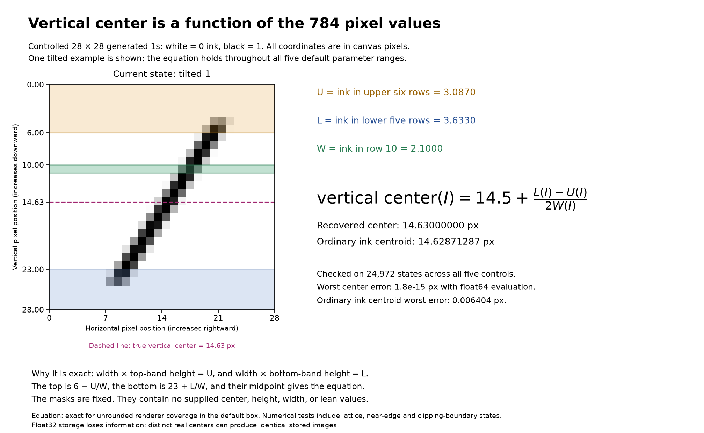

# Exact state-derived coordinates and finite knob functions

[Read the rendered mathematical note (PDF)](mathematical_functions.pdf). It presents the functions as equations, without source code.

A vertical center need not be an external input. It can be a scalar function of the 784 image coordinates. The same holds for every parameter used below.

For this controlled family there is an explicit global map from an unrounded image to its five original physical settings, a five-coordinate alternative based on edges and slope, and exact finite image-update functions. All three are given mathematically here. There is no fitted model, neighborhood approximation, or additional measured input.

These equations were reverse engineered from the known straight-stroke geometry and its sixteen-subrow coverage rule. They are not claimed as a discovery from arbitrary unlabeled images.

## Domain and notation

Let \(I_{rc}\) be the ink coverage of pixel row \(r\), column \(c\), where \(r,c\in\{0,\ldots,27\}\). Zero means no ink and one means full ink. Rows increase downward and columns increase rightward. The canvas spans coordinates zero through twenty-eight.

The original physical settings are horizontal center \(c_x\), vertical center \(c_y\), height \(h\), horizontal width \(w\), and lean angle \(\theta\). Their allowed ranges are

\[
14\le c_x,c_y\le15,\qquad19\le h\le20.5,\qquad1.8\le w\le4.6,\qquad-10^\circ\le\theta\le35^\circ.
\]

The exact identities below concern the real-valued coverage equation before storage rounding. Numerical evaluation and float32 storage are checked separately at the end.

## A single function returning vertical center

Define three fixed linear measurements of the current image:

\[
W(I)=\sum_{c=0}^{27}I_{10,c},\qquad
U(I)=\sum_{r=0}^{5}\sum_{c=0}^{27}I_{rc},\qquad
L(I)=\sum_{r=23}^{27}\sum_{c=0}^{27}I_{rc}.
\]

Here \(W\) is the ink in row ten, \(U\) is the ink in the upper six rows, and \(L\) is the ink in the lower five rows. These are pixel sums, not supplied geometric parameters.

The vertical center is the following single rational function of the image:

\[
\boxed{\displaystyle c_y(I)=14.5+\frac{L(I)-U(I)}{2W(I)}.}
\]

Equivalently, if the flattened image is \(x\in\mathbb R^{784}\), three fixed row-selection masks \(m_W,m_U,m_L\) give

\[
c_y(x)=14.5+\frac{(m_L-m_U)^\top x}{2m_W^\top x}.
\]

Thus a fixed three-row matrix followed by one ratio is sufficient. A single function need not be a single linear map.

**Why this is exact throughout the full parameter box.** The stroke's top lies between 3.75 and 5.5 and its bottom between 23.5 and 25.25. Row ten is entirely inside the stroke. No allowed stroke is horizontally clipped by the canvas, even at the subrow midpoints used near its ends. Therefore its total horizontal ink is exactly its width at each contributing subrow.

If \(t\) and \(b\) denote top and bottom,

\[
W=w,\qquad U=w(6-t),\qquad L=w(b-23).
\]

Taking the midpoint of \(t=6-U/W\) and \(b=23+L/W\) proves the boxed identity. The sixteen-subrow vertical weights preserve these identities exactly: their overlap lengths sum to the covered vertical length.

There is no need to infer the first and last occupied row, supply the center, or fit an image-dependent mask. Since \(W\ge1.8\), the denominator is never zero on this family.

Several other state functions follow immediately:

\[
\boxed{\begin{aligned}
w(I)&=W(I),\\
t(I)&=6-\frac{U(I)}{W(I)},\\
b(I)&=23+\frac{L(I)}{W(I)},\\
h(I)&=17+\frac{U(I)+L(I)}{W(I)}.
\end{aligned}}
\]

Height also equals total image ink divided by \(W(I)\). These quantities are derived from the state, not extra inputs or independent knobs.

## Recovering lean and horizontal position exactly

Two full interior rows provide the remaining information. For \(r\in\{10,18\}\), define the ink to the left of integer boundary \(k\):

\[
C_r(k;I)=\sum_{c=0}^{k-1}I_{rc},\qquad k\in\{0,\ldots,28\},\qquad C_r(0;I)=0.
\]

Let \(\kappa_r(I)\) be the smallest integer minimizing \(\left|C_r(k;I)-W(I)/2\right|\). This is a finite minimum over twenty-nine explicit linear measurements. Define

\[
\boxed{\displaystyle \mu_r(I)=\kappa_r(I)-C_r\bigl(\kappa_r(I);I\bigr)+\frac{W(I)}2.}
\]

This is the exact horizontal stroke-center position at height \(r+1/2\), not an ordinary intensity-weighted average of pixel-center positions.

**Why the selected boundary is safe.** Within a full row, the sixteen horizontal intervals share an intersection centered at the middle-of-row stroke center. Its half-width is

\[
\frac w2-\frac{15}{32}|\tan\theta|\ \ge\ \frac{1.8}{2}-\frac{15}{32}\tan35^\circ\ >\ 0.5717.
\]

The nearest integer to that center is at most one-half pixel away and lies strictly inside this common interval. Its cumulative ink differs from half the width by at most one-half. At either end of the common interval that difference exceeds 0.5717; monotonicity of cumulative ink excludes all boundaries outside it from minimizing. Hence every minimizer lies inside every subrow interval.

Inside that intersection, cumulative ink is boundary position minus the average left-edge position. The sixteen subrow midpoints average to the row midpoint, proving the formula for \(\mu_r\). Ties give the same recovered center, so the tie convention does not change the result.

The centerline slope magnitude and intercept are now state functions:

\[
\boxed{\displaystyle s(I)=\frac{\mu_{10}(I)-\mu_{18}(I)}8,\qquad
 a(I)=\mu_{10}(I)+10.5\,s(I).}
\]

The centerline at height \(y\) is \(a-sy\). Positive \(s\) tilts the top rightward, matching the original lean convention.

Finally,

\[
\boxed{\displaystyle c_x(I)=a(I)-s(I)c_y(I),\qquad
\theta(I)=\frac{180}{\pi}\arctan s(I).}
\]

The arctangent returns radians before multiplication by \(180/\pi\); the resulting angle is in degrees.

All five original physical settings are therefore functions of the image. No current physical setting must be supplied to these functions.

## Five sufficient observables, and why these are useful

One possible five-scalar state representation is

\[
\bigl(W(I),U(I),L(I),\mu_{10}(I),\mu_{18}(I)\bigr).
\]

The equations above recover every original setting from these five quantities. The explicit coverage equation below reconstructs every image coordinate. This establishes sufficiency and uniqueness on the unrounded family, rather than merely retaining most variance.

For writing the pixel equation, a convenient equivalent chart is

\[
\boxed{\displaystyle E(I)=q=(t(I),b(I),a(I),w(I),s(I)).}
\]

Its coordinates mean top, bottom, centerline intercept, width, and slope. They are selected because vertical overlap depends on top and bottom, while horizontal overlap depends on intercept, width, and slope. This makes the full coverage function piecewise quadratic in these five coordinates.

The physical settings are recovered from any such \(q\) by

\[
P(q)=\left(a-s\frac{t+b}{2},\ \frac{t+b}{2},\ b-t,\ w,\ \frac{180}{\pi}\arctan s\right).
\]

The allowed coordinate domain \(Q\) is explicit:

\[
\begin{aligned}
14&\le a-s(t+b)/2\le15,&14&\le(t+b)/2\le15,\\
19&\le b-t\le20.5,&1.8&\le w\le4.6,\\
\tan(-10^\circ)&\le s\le\tan35^\circ.
\end{aligned}
\]

The domain is not a rectangular box in the new coordinates. Ignoring these joint inequalities would admit images outside the original family.

## One explicit function defining the entire family

For two intervals, let their overlap length be

\[
\ell([u,v],[z,d])=\max\{0,\min(v,d)-\max(u,z)\}.
\]

For pixel row \(r\) and subrow \(j\in\{0,\ldots,15\}\), define

\[
y^-_{rj}=r+\frac j{16},\qquad
y^+_{rj}=r+\frac{j+1}{16},\qquad
y_{rj}=r+\frac{j+1/2}{16}.
\]

The coverage function for every pixel is

\[
\boxed{\displaystyle
F_{rc}(t,b,a,w,s)=
\sum_{j=0}^{15}
\ell\bigl([y^-_{rj},y^+_{rj}],[t,b]\bigr)
\,\ell\left([c,c+1],\left[a-sy_{rj}-\frac w2,\ a-sy_{rj}+\frac w2\right]\right).
}
\]

The first overlap is vertical covered length; the second is horizontal covered length. Their product is the subrow contribution to the unit-area pixel. There is no extra factor of sixteen: the vertical overlap already contains the subrow's height.

This finite sum of elementary overlap functions defines all 784 output coordinates, including cap and side boundary crossings. It is a mathematical definition of the renderer's coverage rule, not an instruction to invoke the original implementation.

The entire allowed family is

\[
\boxed{\displaystyle \mathcal M=\{F(q):q\in Q\}.}
\]

Moreover, \(E(F(q))=q\) on \(Q\), so \(F(E(I))=I\) for every unrounded valid image. For a candidate image with \(W>0\), the converse test is exact too: it belongs to the family precisely when its recovered coordinates belong to \(Q\) and \(I=F(E(I))\). Geometry summaries alone cannot certify validity; the pixel equality is essential.

## Exact finite navigation from state and five requested changes

Let

\[
\delta=(\delta_x,\delta_y,\delta_h,\delta_w,\delta_\theta)
\]

be requested changes in the original physical knobs. The first four increments are in pixels and the last is in degrees. Current values of the physical settings are not additional inputs.

For \(q=(t,b,a,w,s)=E(I)\), let

\[
c=\frac{t+b}{2},\qquad
s'=\tan\left(\arctan s+\frac{\pi\delta_\theta}{180}\right).
\]

Define one finite transformation of the five derived coordinates:

\[
\boxed{\displaystyle
A_\delta(t,b,a,w,s)=\left(
 t+\delta_y-\frac{\delta_h}{2},\quad
 b+\delta_y+\frac{\delta_h}{2},\quad
 a+\delta_x+s'(c+\delta_y)-sc,\quad
 w+\delta_w,\quad
 s'
\right).
}
\]

The requested image update is the single state function

\[
\boxed{\displaystyle T_\delta(I)=F\bigl(A_\delta(E(I))\bigr).}
\]

Its only variable inputs are the current 784-dimensional image and the five requested increments. Every center, edge, width, and slope used inside it is a derived function of that state. A separate function for any individual knob is obtained by allowing only the corresponding increment to be nonzero.

This formula applies to any finite change whose endpoint remains in the allowed box. It requires no small-step limit and no local SVD basis. It crosses pixel formula boundaries through the same overlap functions that define the family.

In exact arithmetic, whenever the states involved are allowed,

\[
T_0(I)=I,\qquad T_{-\delta}(T_\delta(I))=I,\qquad
T_\eta(T_\delta(I))=T_{\delta+\eta}(I).
\]

These identities include order independence of finite changes in different original physical knobs.

## Original knobs versus another valid five-coordinate chart

An invertible five-coordinate representation can describe the family perfectly while mixing physical knobs. Correlation or visual similarity alone does not establish alignment.

For example, changing top \(t\) alone by \(\varepsilon\), while holding the other four derived coordinates fixed, changes the original quantities by

\[
\Delta c_y=\varepsilon/2,\qquad
\Delta h=-\varepsilon,\qquad
\Delta c_x=-s\varepsilon/2.
\]

It therefore mixes vertical position, height, and—at nonzero slope—horizontal position. This is a legitimate coordinate direction, not the original height or vertical-position knob.

Conversely, an original vertical translation by \(\varepsilon\) has the following derived-coordinate action:

\[
(t,b,a,w,s)\longmapsto(t+\varepsilon,\ b+\varepsilon,\ a+s\varepsilon,\ w,\ s).
\]

The simultaneous intercept adjustment is necessary to preserve original horizontal center.

Let \(R(I)=P(E(I))\) be the five original settings read from an image. The decisive finite alignment test for the proposed navigation functions is

\[
\boxed{\displaystyle R(T_\delta(I))=R(I)+\delta.}
\]

Changing only width must leave the other four recovered physical settings fixed, for example. The equations above satisfy this identity algebraically. Their infinitesimal response matrix is the identity wherever the relevant derivatives exist.

For another proposed chart \(z\), the response matrix

\[
\frac{\partial z_i(F(q(p)))}{\partial p_j}
\]

shows which original physical settings it mixes. Pure alignment up to separate reparameterizations and permutation requires one nonzero physical-knob dependence per coordinate throughout the domain, with each physical knob represented once. Full rank alone only establishes local independence; global invertibility still requires a global argument.

There is no requirement that lean correlate with center. Lean is recovered from the difference between two row-center functions. Their common position carries horizontal translation; their difference carries tilt.

## Experimental checks

The formulas were evaluated against the existing generator on **24,972 states**, comprising 4,096 Sobol samples, a 3,125-state five-level lattice, 1,024 near-face samples, exact and near cap/subrow boundaries, exact and near horizontal side/pixel boundaries, cumulative-half-ink ties, and the canonical root. Repeated settings can occur across these deliberately overlapping checks.

| Recovered physical quantity | Largest absolute error, float64 evaluation |
| --- | ---: |
| Horizontal center | 5.33 × 10⁻¹⁵ px |
| Vertical center | 1.78 × 10⁻¹⁵ px |
| Height | 3.55 × 10⁻¹⁵ px |
| Width | 2.89 × 10⁻¹⁵ px |
| Lean | 2.84 × 10⁻¹⁴ degrees |

Image reconstruction from the recovered state had maximum pixel error **8.55 × 10⁻¹⁵**. An ordinary vertical ink centroid, weighting each row by its pixel-center height, had maximum center error **0.006404 px** over the same tests. It is not the exact center function.

Each individual original knob action was tested at **2,048 source states**, with destination values spanning its entire allowed range. All five functions together account for **10,240 single-knob updates**. The largest pixel error was **1.18 × 10⁻¹⁴**. A separate **2,048 joint updates** had largest pixel error **9.99 × 10⁻¹⁵**. Every update function received only the image and requested increments.

Four five-step application orders at 128 source/target pairs gave largest pixel error **1.80 × 10⁻¹⁴**. Identity, inverse, and recovered-physical-coordinate alignment were checked separately. These numerical results support the equations; the full-domain exactness claim follows from the overlap and inversion identities, not from the finite sample count.

## The exactness limit of stored pixel values

The real-valued coverage family admits the exact state functions above. Default float32 storage does not preserve every real parameter value.

A direct counterexample uses the root with vertical center fourteen and another state with vertical center fourteen plus one-billionth of a pixel. All other settings are identical. Their stored float32 images are bitwise identical. No function of that stored image alone can return both distinct original centers.

The ambiguity also affects navigation: adding the same vertical increment of one-eighth pixel to those two underlying states produces different stored images. One endpoint has an exactly empty next row while the other has a tiny positive coverage there. Thus no state-only function of the rounded bitmap can reproduce every original real-valued physical action exactly.

For float32 images, the tested vertical-center recovery error was at most **3.20 × 10⁻⁸ px**; the largest recovered-setting error was **4.22 × 10⁻⁷ degrees** in lean. The largest joint-update pixel error was **1.24 × 10⁻⁷**. These are storage-precision results, not a claim of mathematical perfection on rounded data. If exact current physical settings are retained separately, this information-loss obstruction is avoided.

## What this resolves

Derived inputs are legitimate when they are explicitly defined state functions. This construction supplies such functions globally, recovers the original physical controls, and provides an exact global finite navigation equation for the unrounded family.

The useful intermediate quantities here are width, top, bottom, centerline intercept, and slope, because they simplify the coverage equation and all five actions. They form a different five-coordinate chart; their finite transformation law preserves the original knob meanings.

This is an explicit, reverse-engineered mathematical solution for this particular family. It does not establish that these are the uniquely simplest coordinates, or that geometry can be recovered this way from an arbitrary image family.

The numerical measurements are recorded in [results.json](results.json). Representative source states, joint-action outputs, and the rounding collision are in [examples_and_checks.npz](examples_and_checks.npz).
