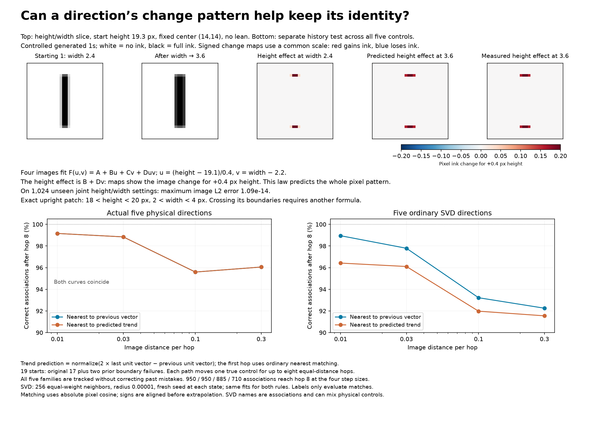
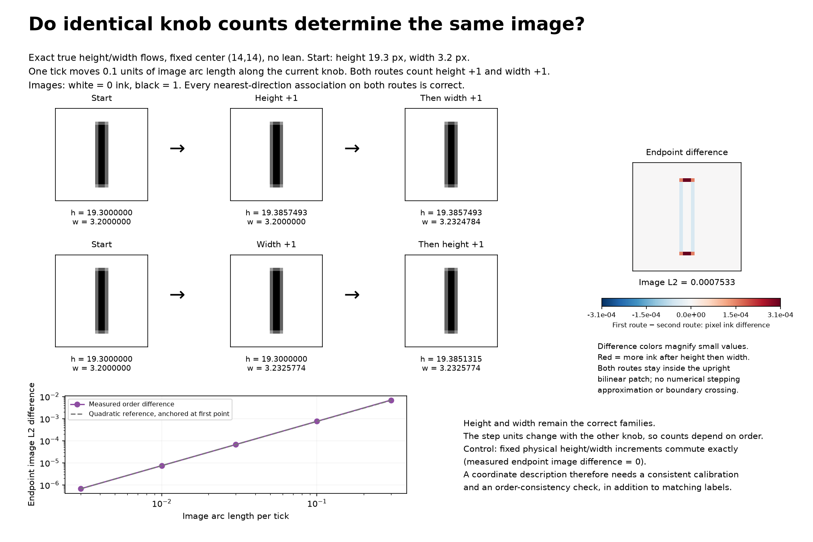

# Direction-change patterns, vector fields, and knob counts

This experiment tests two parts of a proposed construction: match direction
families repeatedly while walking between generated 1s, and use increments
of those families as coordinates relative to a zero state.

**Results:** an exact bilinear height/width law predicts entire pixel-change
patterns to floating-point accuracy within its patch. A simple two-step
unit-vector trend does not improve matching across the five-control family.
Correct matching alone also does not make accumulated counts independent
of order. Ordinary SVD direction fields exhibit an additional obstruction
to serving as coordinate axes, even after changing their individual speeds.

## Recognizing a family by its change pattern



For fixed center `(14,14)` and zero lean, the height/width slice has the form

\[
F(u,v)=A+Bu+Cv+Duv,
\]

where `u=(height-19.1)/0.4` and `v=width-2.2`. Each coefficient is a full
784-pixel array. In the upright patch `18 < height < 20`, `2 < width < 4`,
the vertical and horizontal coverage profiles are affine, and their outer
product gives this bilinear identity.

Here the coefficients are **fit from four rendered images**, at the four
corners `u,v ∈ {0,1}`, rather than copied from the renderer's derivative code.
The four-image linear system determines the four pixel arrays. Prediction
uses only the fitted coefficients and supplied coordinates.

On 1,024 held-out joint settings spanning heights 18.2–19.9 and widths
2.05–3.95, the largest image L2 reconstruction error is **1.09e-14** and the
largest pixel error is **3.56e-15**. This includes extrapolation beyond some
of the training corners while remaining inside the same upright patch.

The coordinate families have the precise mathematical definitions

\[
V_u(u,v)=\partial_uF=B+Dv,\qquad
V_v(u,v)=\partial_vF=C+Du.
\]

Consequently

\[
V_u(u,v+\delta)-V_u(u,v)=D\delta,
\quad
\partial_vV_u=\partial_uV_v=D.
\]

This predicts the full signed pixel pattern, not just its norm or angle.
The fitted mixed derivative has norm 0.2 in these calibrated coordinates,
equivalent to 0.5 per physical height/width unit. Translating u and v can put
any reference state inside this patch at coordinate zero without changing
the type of equation.

This is a mathematical parameterization of a two-dimensional manifold patch;
code evaluates the equation. Four images alone cannot certify an arbitrary
unknown family: the exactness claim here also uses the known renderer's
affine-profile structure. Coordinates were supplied for this control, not
discovered from unlabeled images. Extending it to all five controls and
across formula boundaries remains separate work.

## Repeated tracking: nearest vector versus recent trend

Use the original 17 starts plus the two random starts previously found to
have cy/height boundary confusions, `additional_76` and `additional_128`.
These are 19 selected test starts, not 19 new random draws.

At each start, move each true physical control in both signs for up to eight
successive hops. Each hop has actual Euclidean image distance 0.01, 0.03,
0.1, or 0.3. Track **all five** source families along each path, including
the four whose physical control is not being moved. This isolates matching
quality on identical paths; the paths do not depend on the matching rule.

At every new state, ordinary uncentered SVD uses 256 equal-weight neighbors
at image radius 0.00001 and a fresh sampling seed. All matchers receive
exactly the same fitted frames. Known derivatives are used to generate
paths and evaluate associations, not by the prediction/matching rules.
SVD names are one-to-one evaluation categories against the true derivatives;
fitted vectors may mix physical knobs.

Compare two rules, after aligning arbitrary vector signs:

1. **Nearest:** select the candidate with largest absolute cosine to the
   previous matched unit vector.
2. **Trend:** predict `normalize(2*last - previous)` from the two most recent
   unit vectors, then select the nearest candidate. The first hop uses the
   nearest rule because no trend is available yet.

Both make independent choices for each family. Thus labels can collide.
Once a match is wrong, the new chosen direction becomes that family's
history; these are actual repeated tracking runs without correcting errors.
The known controls never choose the next match.

### Associations remaining correct after hop eight

| Image distance per hop | True directions: nearest | True directions: trend | SVD: nearest | SVD: trend |
| --- | ---: | ---: | ---: | ---: |
| 0.01 | 942 / 950 | 942 / 950 | 940 / 950 | 916 / 950 |
| 0.03 | 939 / 950 | 939 / 950 | 929 / 950 | 913 / 950 |
| 0.1 | 846 / 885 | 846 / 885 | 825 / 885 | 814 / 885 |
| 0.3 | 682 / 710 | 682 / 710 | 655 / 710 | 650 / 710 |

Larger steps have fewer completed paths because parameter bounds are reached.
Every association uses all 784 pixels. An independent nearest match counts
as successful only when the expected category is uniquely best, with margin
greater than 1e-10. Finite hop tests establish empirical performance, not a
guarantee for arbitrary starts or distances.

At distance 0.01, the actual physical cy and height families switch at hop 4
for `additional_76` and hop 7 for `additional_128`, when the moving stroke
end crosses a pixel-row boundary. These failures did not occur at the
initial 0.01 hop of the earlier experiment. Repeated walking encounters
new states and new formula boundaries; a previously successful step size
is not a uniform guarantee for the whole path.

Two additional diagnostics are saved:

- **Correct-past diagnostic:** provide correct associations for the past
  vectors, then predict one new hop. Across hops 2–8 and all step sizes,
  the trend rule rescues 6 SVD associations but harms 203 that nearest
  would match correctly. These past labels use ground truth, so this is
  a diagnostic of prediction quality rather than an available tracking rule.
- **Joint matching:** assign all five candidates one-to-one using maximum
  total absolute cosine, preventing duplicate labels. These supplemental
  counts score assignment correctness, without requiring each assigned
  candidate to be the independent nearest. At hop eight and distance 0.1,
  nearest joint matching gives 847/885 for SVD, versus 835/885 with trend.

The true-field trend and nearest rules made exactly the same decisions in
this sample. This negative result concerns this particular two-step trend;
it does not rule out richer models of direction change.

### Sampling controls

`history_tangent_limit_control.json` repeats tracking with the analytic
radius-zero limit of the same 256-ray ordinary SVD, using identical rays
at every state. It uses the known Jacobian and is a diagnostic control,
not a pixel-only estimator. Exclude 152 paths with a tilted cap kink at
some stored state, because a unique two-sided tangent limit need not exist
there. Intervening paths can still cross formula boundaries.

The trend again gives no improvement in one-hop comparisons with correct
past associations. In repeated tracking it makes one additional mistake at
step 0.3 and otherwise gives the same aggregate counts. Finite neighborhoods
and fresh sample changes therefore are not the only issue with the heuristic.
The file also gives sampled-SVD results on exactly the same retained paths.

As a separate noise control, fresh neighborhood samples at 19 stationary
images yield 665/665 correct associations for both rules over hops 2–8.
These controls do not fully attribute the extra fitted-SVD errors to noise
versus changes in the fitted field.

## Correct labels can still give order-dependent counts



Start at `(14,14,19.3,3.2,0)` and define one tick to mean 0.1 units of image
arc length along the current true physical knob. Apply height +1 and width
+1 in either order. Both paths remain inside the upright bilinear patch,
and every nearest-direction association along them is correct.

| Order | Final height | Final width |
| --- | ---: | ---: |
| Height, then width | 19.385749293 | 3.232478361 |
| Width, then height | 19.385131459 | 3.232577438 |

The endpoint image difference is **0.0007533135**. At tick sizes 0.003,
0.01, 0.03, 0.1, and 0.3, the respective differences are approximately
6.72e-7, 7.47e-6, 6.74e-5, 7.53e-4, and 6.89e-3. The order effect scales
approximately quadratically for small ticks.

This is not an Euler-integration error: inside this patch each physical
knob's image derivative is constant along its own flow line, so its exact
unit-image-speed flow is the physical increment `tick / derivative_norm`.
Those norms depend on the other knob. Fixed physical height/width increments
give exactly the same endpoint in either order, with measured image
difference zero. This example isolates a calibration problem despite
perfectly associated direction families.

## SVD families can have a stronger coordinate obstruction

For independent calibrated fields V_i to act as coordinate partials,
their flows must locally commute. The infinitesimal test is the Lie bracket

\[
[V_i,V_j]=D_{V_i}V_j-D_{V_j}V_i.
\]

See the [MIT notes on vector fields and integrability](https://math.mit.edu/classes/18.966/2014SP/965/class4.pdf)
for the bracket, commuting flows, and local coordinate construction.

`check_generated_one_direction_commutators.py` tests three generic smooth
starts with three sampling seeds. Ordinary SVD neighborhoods use radius
0.000001 and the same 256 sampling rays at nearby states, so they define a
reproducible field rather than independent sampling noise. Directions are
matched and sign-aligned with the source frame. The known Jacobian supplies
parameter lifts for valid nearby states and converts brackets back to
pixel space. All central-difference states share their source's formula
signature; no renderer boundary is involved.

For SVD axes 1 and 5, the bracket has a substantial component **outside the
span of those two directions** at all nine start/seed combinations. In the
analytic radius-zero SVD limit, its norm ranges from approximately 0.16155
to 0.39672. For the first start and first seed it is
**0.174086684**, stable within 2e-10 across difference steps 0.0001, 0.00003,
and 0.00001. Direct finite-shell measurements agree closely; their smaller
difference steps amplify rendering/fitting roundoff.

An outside-pair component cannot be removed by individually rescaling the
two fields, since

\[
[aV_i,bV_j]=ab[V_i,V_j]+aV_i(b)V_j-bV_j(a)V_i.
\]

The additional terms lie inside the original pair. Thus these particular
ordinary SVD direction families cannot all become coordinate axes merely
by adjusting tick sizes. This is measured for the specified frame and
starts, not a claim about every possible field on this manifold. It does
not mean the manifold lacks five-coordinate descriptions.

## What constitutes a mathematical knob description

A family V_i(x) assigning a tangent vector at each image x is a vector-field
description. With a chosen calibration, its knob movement is the flow
`dx/dt = V_i(x)`. A stored correspondence table approximates such a field;
a fitted equation specifies how it varies between stored states.

A decoder F(q) supplies both the image and its coordinate families
`V_i(F(q)) = partial_i F(q)`. The bilinear control above is a concrete
example with an interaction law and held-out joint reconstruction checks.

Successful direction tracking alone does not ensure that the five accumulated
counts are an order-independent description of state. One possible local
construction for smooth independent fields is to prescribe a fixed order
of their flows from the root:

`F(q) = flow_5(q5) ∘ ... ∘ flow_1(q1)(root)`.

Its derivative at zero has the five independent root fields as columns, so
the inverse-function theorem gives a local chart. If the fields do not
commute, changing a coordinate at an arbitrary state need not equal simply
following its original SVD field there. This construction is a mathematical
option, not an implemented or validated global decoder in this experiment.

## Reproduce and inspect

```bash
OPENBLAS_NUM_THREADS=1 .venv/bin/python analyze_generated_one_direction_history.py
OPENBLAS_NUM_THREADS=1 .venv/bin/python check_generated_one_direction_commutators.py
OPENBLAS_NUM_THREADS=1 .venv/bin/python verify_generated_one_direction_history.py
OPENBLAS_NUM_THREADS=1 .venv/bin/python report_generated_one_direction_history.py
```

Inputs include the earlier nearest-direction experiment's compressed results.
The main run makes 5,801 endpoint fits, over 760 possible start/control/sign/
step-size paths, stopping at the same endpoint bounds as that experiment.

- `history_trials.json.gz`: paths, states, per-hop choices, margins, and counts.
- `summary.json`: methods, aggregate counts, bilinear fit accuracy, and exact
  count-order control.
- `bilinear_coefficients.npz`: four learned pixel arrays in A,B,C,D order.
- `commutator_check.json`: direct shell and analytic tangent-limit brackets,
  seeds, difference steps, and formula-cell checks.
- `history_tangent_limit_control.json`: fixed-sampling radius-zero control.
- `verification.json`: saved-record audit and stationary-sampling control.

All rendered hop distances were independently rechecked; their maximum
absolute error was **1.54e-13**. Saved count and collision arithmetic passed
audit. The bilinear joint reconstruction and exact unit-speed flows have
numerical assertions. `git diff --check` passed. Final figures were inspected
and revised to remove overlapping labels and define units and normalization.
