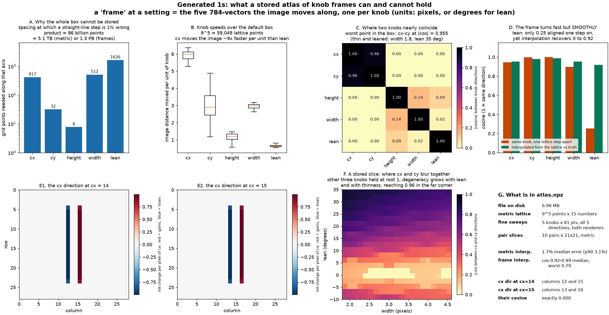

# An atlas of knob frames, and the measurement of why it is slices

Built by `build_generated_one_knob_atlas.py`, with the reusable API in
`knob_frames.py`. Numbers in `results.json`, data in `atlas.npz` (6.98 MB).

A **frame** at a setting is the five 784-vectors the image moves along, one per
knob -- the columns of the Jacobian. Its 5x5 Gram matrix `G = J J^T` carries the
knob speeds on its diagonal and the interactions off it, which is what "how does
lean vary with width here" means numerically.

The request was to tabulate those frames across the box and stop re-deriving
them. Part 1 is whether that is affordable.



## 1. A dense map is impossible, by eight orders of magnitude

For each knob, bisect for the step at which a straight-line prediction of the
image is 1% wrong -- the spacing a lattice would need to be locally linear:

| Knob | range | 1% step | points needed on that axis |
| --- | ---: | ---: | ---: |
| cx | 1.00 px | 0.0024 | 417 |
| cy | 1.00 px | 0.0314 | 32 |
| height | 1.50 px | 0.1935 | 8 |
| width | 2.80 px | 0.0055 | 512 |
| lean | 45.0 deg | 0.0277 | 1626 |

Product: **86 billion points**. At 15 float32 for the metric that is **5.1 TB**;
at 15.7 kB for the five direction vectors, **1.3 PB**. A 10-20 MB budget buys
about a thousand points with frames, or a million with metrics only -- roughly
16 per axis against the hundreds-to-thousands required.

Note which knobs are expensive. `height` needs 8 points and `lean` needs 1626,
a factor of 200, so a uniform lattice is the wrong shape even before it is the
wrong size.

## 2. What is stored instead

`atlas.npz`, float32 throughout, raw units (pixels; degrees for lean):

| Key | Shape | What it is |
| --- | --- | --- |
| `lattice_axes` | (5, 9) | axis values of the coarse 5D lattice |
| `lattice_metric` | (9,9,9,9,9,15) | `G` flattened to upper-triangular entries |
| `metric_index` | (15, 2) | which `(i, j)` each of the 15 entries is |
| `sweep_knobs` | (5, 81, 5) | one knob swept through root 1, others fixed |
| `sweep_jac_grey` | (5, 81, 5, 784) | all five directions, `grey_ones` |
| `sweep_jac_smooth` | (5, 81, 5, 784) | the same, `smooth_ones` |
| `sweep_step_sensitivity` | (5, 81) | `|J(h) - J(2h)| / |J(h)|`, a crease warning |
| `pair_index`, `pair_axes`, `pair_metric` | (10,2), (10,2,21), (10,21,21,15) | all ten knob pairs, metric only |

`knob_frames.py` computes any of this fresh at arbitrary settings
(`jacobian`, `metric`, `frame`, `speeds`, `knob_cosines`, `load_atlas`).
Central-difference steps are 1e-4 of each knob's range; lean's 0.0045 deg sits
below the ~0.022 deg crease spacing from
`figures/generated_one_crease_origin`, so a difference usually stays inside one
smooth piece. Median step sensitivity is 1.0e-4 to 6.4e-4, lean the largest.

## 3. Knob speeds and where two knobs blur together

Over the lattice, image distance moved per unit of knob:

| Knob | min | median | max |
| --- | ---: | ---: | ---: |
| cx | 5.27 | 5.97 | 6.36 |
| cy | 1.19 | 2.90 | 4.88 |
| height | 0.58 | 1.19 | 1.48 |
| width | 2.64 | 2.99 | 3.18 |
| lean | 0.55 | 0.63 | 0.86 |

cx moves the image about nine times faster per unit than lean, and `cy` varies
by a factor of four across the box while `cx` and `width` barely vary at all.

The frame is never orthogonal and sometimes nearly degenerate. At root the only
appreciable overlap is height-width at 0.144. The worst point in the box is
**cx-cy at |cos| = 0.955**, at width 1.8 and lean 35 -- a thin, strongly leaned
stroke, where moving it down also moves it sideways along its own slant, so the
two translations do almost the same thing. Metric condition number runs 66 to
135 across the box. Panel F maps this over the width-lean plane.

## 4. The frame turns fast, but smoothly

Two measurements that sound contradictory and are not:

| Knob | cosine one lattice step apart | cosine after interpolating the lattice |
| --- | ---: | ---: |
| cx | 0.945 | 0.954 |
| cy | 0.997 | 0.979 |
| height | 1.000 | 0.986 |
| width | 0.897 | 0.954 |
| lean | **0.254** | **0.919** |

One lattice step in lean is 5.6 degrees, and the lean direction there is almost
unrelated to where it started. But the rotation is smooth, so linear
interpolation between two far-apart corners lands near the true direction in
between: 0.92 median, 0.83 worst. Interpolating the **metric** is better still,
1.7% median relative error (p90 3.1%).

So the coarse lattice is usable for the metric, and usable-with-care for
frames. What it cannot do is let you treat a frame as constant between lattice
points.

## 5. One knob's direction can go exactly orthogonal to itself

The sharpest statement of the handoff in
`figures/generated_one_pixel_humps`. Sweep `cx` from 14 to 15 with the stroke
upright, and compare the cx direction at the two ends:

```
cx direction at cx = 14 : lives on columns 12 and 15
cx direction at cx = 15 : lives on columns 13 and 16
cosine between them     : exactly 0.000
```

Not nearly orthogonal -- disjoint. Moving a vertical stroke by one pixel hands
"shift right" to an entirely different pair of pixels. Panels E1 and E2 show it.
Same for cy, height and width, all exactly 0.0 end to end; lean reaches -0.012.

On `smooth_ones` the same comparisons give 0.38, 0.54, 0.55, 0.26 and -0.05: the
soft edges spread each direction over more pixels, so supports keep overlapping.
The exact zeros are a hard-edge effect; the large rotation is not.

## What this is good for, and what it is not

Good for: looking up knob speeds and interactions anywhere in the box without
recomputing; a fixed convention so experiments share one finite-difference step
and one metric ordering; the fine sweeps as ground truth for transport,
curvature and commutator work; the degeneracy map for choosing where to sample.

Not a map of the manifold, and not a route to the knobs. Every entry is indexed
by knob values, so this describes a generator already known. The honest lesson
of part 1 is the one that keeps recurring: storing the frame field does not
scale, while the closed form in
`figures/generated_one_gradient_fields` -- two spatial gradients and a position
weight -- reproduces any frame on demand in constant space.
