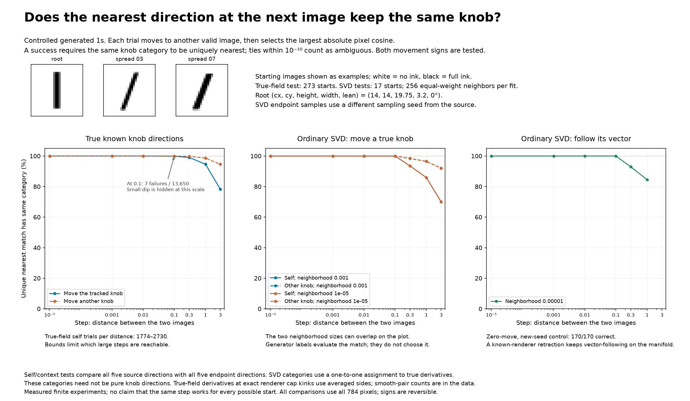
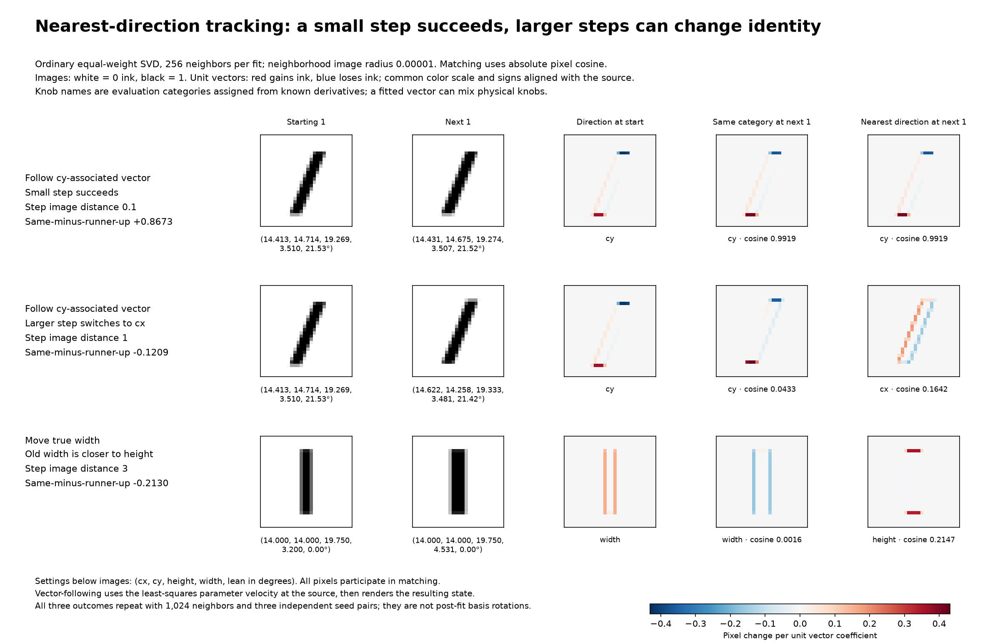

# Nearest-direction continuation on generated 1s

Question: after moving to another valid generated 1, does the direction with
the largest absolute cosine retain the same knob association?

**Result:** this worked for every sufficiently small step in this finite
sample, including directions that changed measurably. It failed at larger
steps. A larger random control also found rare failures at an image distance
of 0.1 near stroke-end pixel boundaries. There is no universal successful
step size established here.



## What was measured

These are the controlled 28×28 coverage images from `grey_ones.py`, not MNIST.
An image is a point in 784-dimensional pixel space; each pixel is ink coverage
between 0 and 1. All rendering and comparisons here retain float64 coverage.
The canonical root settings are `(14, 14, 19.75, 3.2, 0)` in the order
`(cx, cy, height, width, lean)`, with lean in degrees.

Two distances must be distinguished:

- **Neighborhood radius r:** distance from the image to each training neighbor
  used to estimate the local basis. Tested values: 0.001 and 0.00001.
- **Step distance d:** distance between the starting image and the next image.
  Tested values: 0.00001, 0.001, 0.01, 0.1, 0.3, 1, and 3; following an SVD
  vector was tested through 1. These are Euclidean image distances, not pixels
  or degrees of parameter change.

Each SVD uses 256 equally weighted neighbors on an image-distance shell.
Parameter rays are sampled using the same normalized-control sampling design
as the earlier experiments. The matrix rows are neighbor images minus the
starting image, without subtracting the neighborhood mean. This is ordinary
SVD: no pixel weighting, whitening, or rotation of the fitted basis. Removing
exactly zero pixel columns before SVD only reduces computation. The analytic
Jacobian initializes shell searches; measured rendered distances determine
the final neighbors, with relative shell error below 0.000003.

The first five right singular vectors are retained under the question's
five-vector assumption. This experiment does not repeat dimension selection.
In particular, the renderer's nonsmooth boundaries can require more than
five first-order linear directions. Source and endpoint fits use different
sampling seeds, 20261010 and 20261021.

For every queried source direction, the matcher independently chooses the
endpoint direction maximizing `abs(source @ candidate)` after unit
normalization. Thus both signs represent the same axis. It uses no knob names
and no enforced one-to-one correspondence. A success requires the expected
category to be uniquely nearest; scores tied within 1e-10 count as ambiguous.
Whole-frame one-to-one matching is also saved, but is not the rule reported
in the main figures and tables.

To evaluate SVD results, each fitted frame is assigned one-to-one to the five
known generator derivatives by maximum total absolute cosine. These names
are **evaluation categories, not proof that an SVD vector is a pure physical
knob**. A vector can mix several physical controls. Oracle comparisons below
use the actual five generator derivatives instead, avoiding this ambiguity.

## Three complementary tests

### Follow an estimated SVD vector

At each of the original 17 starts, follow each of the five fitted directions
in both signs. A literal pixel addition generally leaves the image family.
To produce valid endpoints, use the known generator's Jacobian J to compute
the least-squares parameter velocity `v = pinv(J) @ b`, then render `p + t*v`.
Choose t by the requested rendered image distance. This follows the source
direction to first order when it is tangent, rather than substituting a pure
knob move. Projection error is recorded for each trial.
The median unit-vector projection error is 3.47e-8 and the maximum is
0.001372, so a small projection mismatch remains in some fitted directions.

This is a known-model construction for testing the matching idea, not a
method that has already learned how to stay on the manifold from pixels alone.
The parameter ray is held fixed during each step; the vector field is not
re-estimated continuously along that ray.

| Image step d | Correct unique matches | Rate |
| --- | ---: | ---: |
| 0.00001 | 170 / 170 | 100% |
| 0.001 | 170 / 170 | 100% |
| 0.01 | 170 / 170 | 100% |
| 0.1 | 170 / 170 | 100% |
| 0.3 | 157 / 169 | 92.9% |
| 1 | 120 / 142 | 84.5% |

The fitting radius here is 0.00001. Larger steps have fewer trials because
some parameter rays reach the allowed endpoint bounds first. Endpoint bounds
are cx/cy 13–16, height 19–20.5, width 1.8–4.6, lean −10–35 degrees; shell
neighbors themselves may extend slightly beyond these bounds.

### Move a true knob, compare the entire fitted frame

At each of the same 17 starts, move each true knob in both signs, then compare
all five source SVD directions with all five endpoint directions. This tests
both the direction associated with the moved knob and the four directions
whose context changed. Counts below are **per fitting radius**. The two radii
gave identical success counts, although the fitted vectors are not identical.

| Image step d | Moved-knob category | Other four categories |
| --- | ---: | ---: |
| 0.00001 | 170 / 170 | 680 / 680 |
| 0.001 | 170 / 170 | 680 / 680 |
| 0.01 | 170 / 170 | 680 / 680 |
| 0.1 | 170 / 170 | 680 / 680 |
| 0.3 | 158 / 169 | 665 / 676 |
| 1 | 122 / 142 | 548 / 568 |
| 3 | 77 / 110 | 405 / 440 |

Independent neighborhood samples at the exact same image gave 170/170
correct zero-move controls across the two radii. At distance 0.1 and fitting
radius 0.00001, corresponding SVD categories turned by a median of 3.22° and
up to 16.14°. Those angles include finite-sample changes as well as state
changes; the oracle test provides a comparison without neighborhood noise.

### Compare true physical directions at 273 starts

Add 256 Sobol random starts, sampled in the middle 80% of the default control
ranges, to the original 17. At each start, move each of the five true knobs
in both signs, and compare all five analytic generator derivatives. Again,
the nearest matcher sees only normalized pixel vectors.

| Image step d | Correct unique matches, all five directions |
| --- | ---: |
| 0.00001 | 13,650 / 13,650 |
| 0.001 | 13,650 / 13,650 |
| 0.01 | 13,650 / 13,650 |
| 0.1 | 13,643 / 13,650 |
| 0.3 | 13,347 / 13,395 |
| 1 | 11,524 / 11,780 |
| 3 | 8,100 / 8,870 |

All seven failures at 0.1 involve cy/height at two added starts, near a
stroke-end crossing of the pixel-row boundary y=24. Both endpoints can be
smooth while the intervening path crosses a derivative boundary. Central
rendered differences with parameter step 1e-6 confirm those analytic
derivatives to an image-vector error below 1e-7. A selected SVD follow-up at
those same pairs also fails in 8 of 14 comparisons across the two radii.
These selected follow-ups are not included in the original 17-start rates.

At exact renderer cap kinks the analytic implementation averages the two
sides. Such pairs are flagged, and `aggregate.csv` also reports a subset
excluding flagged endpoints. Endpoint filtering does not exclude paths that
cross a kink between endpoints.

A concrete example of a changing direction that remains identifiable:
at `spread_04`, increasing cx by about 0.01643 px gives image distance 0.1.
The true width direction turns by **7.03°**, yet width remains uniquely
nearest, with cosine 0.99248 and a margin of 0.89486 over the best alternative.
Thus tracking can succeed while a different knob changes the direction.

## Inspectable examples and repeat checks



The first two rows follow the same cy-associated SVD direction at `spread_07`.
At image distance 0.1, the matching category remains cy. At distance 1, the
nearest direction is cx. The third row increases true width at the canonical
root from 3.2 to about 4.53: the old width-associated vector becomes closer
to the new height-associated vector than to the new width-associated vector.
These are ordinary fitted SVD vectors, without post-fit rotations.

All three displayed outcomes repeat with 1,024 neighbors and three different
source/endpoint seed pairs. The two failures have negative margins in every
repeat, approximately −0.20 for root width and −0.13 for the cy-associated
vector. The successful smaller step retains a positive margin above 0.91.
Records are in `larger_sample_verification.json`.

## Why small steps can work mathematically

Suppose the actual direction families are continuous unit fields u_i(p) on
a smooth patch. At a particular state p, define the separation margin

\[
m_i(p)=1-\max_{j\ne i}|u_i(p)^\top u_j(p)|.
\]

If this is positive and all five fields change by less than m_i(p)/2 in
unit-vector norm, with signs chosen continuously, the same family must be
uniquely nearest at the new state. Its cosine stays above 1−epsilon, while
every competitor stays below 1−m_i+epsilon. Continuity therefore gives a
**state-dependent sufficiently small step**. This is a conditional local
guarantee, not a proof that unlabeled observations select unique physical
families. At nonsmooth renderer boundaries its continuity premise can fail.

For SVD axes, analogous continuation requires a stable neighborhood
covariance and separated singular values. Nearly equal values allow axes to
rotate or swap. Even a successfully continued SVD axis can remain a mixture
of physical knobs. Local nearest matching therefore supplies a useful
continuation rule, not a complete identification of the generator controls.

There is no need to impose a minimum step to preserve identity: smaller
steps generally help until sampling and numerical errors dominate. To study
how a direction bends over a larger region, many small matched steps can be
accumulated. Whether the resulting associations agree along different paths
remains untested here; local matches alone do not establish global consistency.

## Reproduction and files

From the repository root:

```bash
OPENBLAS_NUM_THREADS=1 .venv/bin/python analyze_generated_one_nearest_direction.py
OPENBLAS_NUM_THREADS=1 .venv/bin/python verify_generated_one_nearest_direction.py
OPENBLAS_NUM_THREADS=1 .venv/bin/python report_generated_one_nearest_direction.py
```

- `results.json.gz`: complete trial records, starting/ending settings,
  matching scores, fit spectra, shell errors, and controls.
- `basis_vectors.npz`: fitted source/endpoint vectors for inspection.
- `*_comparisons.csv.gz`: compressed row-level tables for the three arms.
- `summary.json` and `aggregate.csv`: directly readable summaries, including
  self/context, fitting radius, and smooth-endpoint subsets.
- `larger_sample_verification.json`: nine larger-neighborhood repeat trials.
- `rare_true_field_verification.json`: finite-difference validation and
  selected ordinary-SVD follow-ups of the seven early oracle failures.

The experiment tests nearest-direction association. It does not establish
unique physical knob discovery, a pixel-only manifold flow, a global decoder,
or a universal successful distance.

Additional checks recomputed all saved matching decisions and followed-vector
cosines. Every saved five-vector frame was orthonormal to within 2.45e-15.
Representative endpoint distances and bounds were rechecked, and the maximum
saved endpoint-fit relative shell error was 1.91e-6. `git diff --check` passed.
