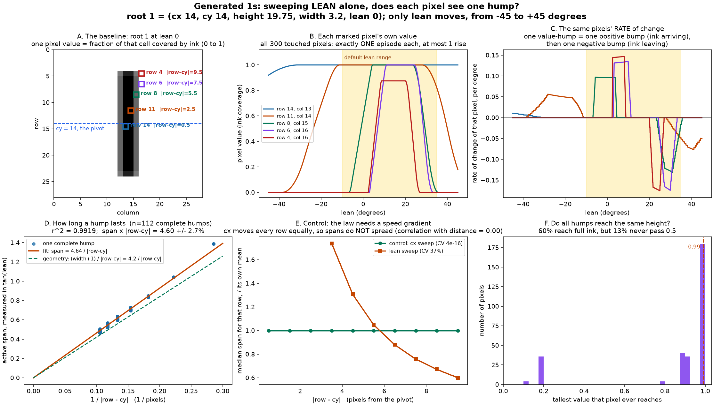
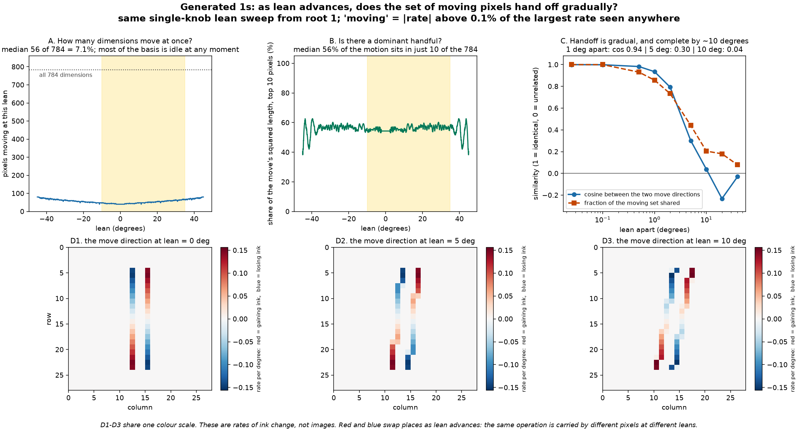

# A knob sweep, seen one pixel at a time: humps that hand off

Built by `analyze_generated_one_pixel_humps.py`. Numbers in `results.json`,
raw sweep in `sweep_data.npz`.

Every other experiment here describes a knob move by what it does to the whole
784-vector. This one asks whether the move can be described **one dimension at a
time**: watch a single pixel while only lean changes, and see whether its story
is simple. It is, and the structure turns out to be sharp enough to state as a
law with a control.

Everything below is a single-knob sweep from root 1
`(14.0, 14.0, 19.75, 3.2, 0.0)`, lean running -45 to +45 degrees. That is wider
than the default -10 to 35 box, which the figures shade, so that whole humps are
visible rather than truncated at the box edge.

## 1. One pixel, one episode



300 of the 784 pixels are touched at any point in the sweep. Of those:

| Measure | Result |
| --- | ---: |
| pixels with exactly ONE contiguous active episode | **100%** |
| most episodes seen on any pixel | 1 |
| most separate rises seen on any pixel | 1 |

So the per-pixel picture is exactly: flat at zero, one rise, one fall, flat at
zero. No pixel is visited twice, and none wobbles on the way up. The reason is
geometric rather than lucky -- at a fixed row the stroke's horizontal position
is `cx - tan(lean) * (row - cy)`, which is monotone in `tan(lean)`, so the stroke
crosses a given pixel once and never comes back.

In the rate of change (panel C) one value-hump appears as **two** bumps: a
positive one as ink arrives, a negative one as it leaves. A dimension's
involvement in the move is therefore two-signed, not one.

## 2. How long a hump lasts, and the control that makes it meaningful

Rows far from `cy` are swung fast, rows near `cy` barely move. Predicted law:
the active span, measured in **tan of lean** rather than in degrees, is

```
span = (width + 1) / |row - cy|
```

The `width + 1` is the stroke's width plus the pixel's own width; the division is
the lever arm. Measured over the 112 humps that complete inside the sweep:

| Quantity | Value |
| --- | ---: |
| r^2 of `span` against `1 / |row - cy|` | **0.9919** |
| fitted numerator | 4.64 |
| geometric prediction `width + 1` | 4.20 |
| `span x |row - cy|`, spread across all 112 | 4.60 +/- 2.7% |

The fitted numerator runs 9.6% above `width + 1` because a pixel is a square, not
a line: the stroke reaches a pixel's near corner slightly before its centre row
and leaves slightly after.

**Control.** A law of the form "duration falls with distance from the centre"
would be worthless if it also fitted a sweep with no speed gradient. `cx` moves
every row at the same speed, so it should show no spread at all:

| Sweep | spread of per-row span (CV) | correlation with `|row - cy|` |
| --- | ---: | ---: |
| lean | 37% | strong, `1/d` |
| **cx (control)** | **4e-16** | **0.00** |

The cx spans are identical across every row to machine precision, at 4.195 px
against a predicted `width + 1 = 4.2`. The law is reading lean's lever arm, not
an artefact of the measurement.

## 3. Heights are not all alike

The one part of the hump picture that does not hold cleanly. 60% of touched
pixels reach full ink, but **13% never pass 0.5** -- these are the columns the
stroke only ever clips, at the left and right extremes of its travel. Median
peak is 1.0, so "most humps reach the top" is right; "they all do" is not.

## 4. At any one lean, most of the basis is idle



| Measure | Result |
| --- | ---: |
| pixels moving at a typical lean | **56 of 784 = 7.1%** |
| most ever moving at once | 80 |
| share of the move's squared length held by the top 10 pixels | **56%** |

So a lean move is carried, at any instant, by a few dozen dimensions, with over
half the motion concentrated in ten of them. "A dominant handful plus a tail" is
an accurate description.

## 5. The handoff is gradual, and complete within about ten degrees

How much does the direction of travel at one lean resemble the direction a
little later?

| Lean apart | cosine between the two directions | fraction of the moving set shared |
| ---: | ---: | ---: |
| 0.025 deg | 0.9999 | 1.00 |
| 0.5 deg | 0.982 | 0.93 |
| 1 deg | 0.935 | 0.86 |
| 2 deg | 0.793 | 0.73 |
| 5 deg | 0.301 | 0.44 |
| 10 deg | **0.038** | 0.20 |
| 20 deg | -0.232 | 0.18 |

Neighbouring leans share nearly everything; ten degrees apart the two directions
are **orthogonal**, and share only a fifth of their moving pixels. Panels D1-D3
show it directly: the red and blue stripes migrate across the canvas and swap
sides. The same operation, "lean a bit more", is carried by an almost entirely
different set of dimensions at lean 10 than at lean 0.

That is the cost of the pixel basis stated in one number. It is also why
transporting a direction by matching pixel patterns
(`figures/generated_one_nearest_direction`) works for small steps and fails for
large ones: past a few degrees there is nothing left to match.

## 6. The humps are geometry, not the grid

Run the same census on `smooth_ones`, which has no `clip/min/max` anywhere:

| | coverage | smooth |
| --- | ---: | ---: |
| pixels touched | 300 | 488 |
| exactly one episode | 100% | 100% |
| most rises on any pixel | 1 | 1 |
| median peak | 1.00 | 0.73 |
| peaks below 0.5 | 13% | 47% |

The hump STRUCTURE survives the decision-free renderer untouched: still one
episode, still one rise. What changes is the hump's shape at its feet -- the
coverage version arrives with a corner, the smooth version with an exponential
tail (which is also why it registers more touched pixels at any threshold, and
why "touched" there is threshold-dependent rather than exact).

So the humps are a property of a stroke sweeping across a grid, and the creases
of `figures/generated_one_crease_origin` are a separate property of how the
grid records it.

## What this settles, and what it does not

Settled: the per-pixel description is correct and tight. One episode per pixel,
one rise, duration exactly inverse in distance from the pivot, a few dozen live
dimensions at a time with a dominant ten, and a handoff that completes in about
ten degrees.

Not settled, and worth being explicit about: none of this is a route to the five
knobs. Every quantity here is a consequence of already knowing what lean does.
The description is faithful but it is bookkeeping over 784 dimensions, whereas
`figures/generated_one_motion_discovery` gets the same move out of two spatial
gradients and a position weight, with no per-pixel census at all. The humps
explain why pixel-basis methods struggle; they are not a replacement for them.
