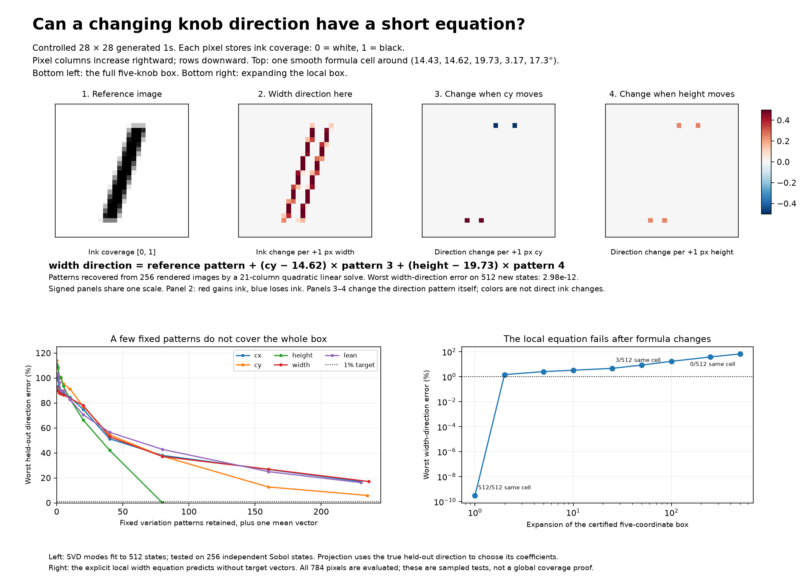

# Second-level SVD: compressing how generated-one directions vary

## What the earlier SVD actually used

The root/local-bases experiments used 512 rendered neighbors for fitting and 256 independent checking neighbors. Each row was the 784-pixel vector `neighbor image - starting image`; all five knobs varied together. The neighborhood mean was not subtracted. The five leading right singular vectors approximate a local space, and need not be five pure physical knobs. At root and radius 0.001 their derivative-assignment cosines were approximately 1, 1, 1, 0.9987, 0.9884. The worst held-out displacement error with five vectors was 0.0119%. These are distinct metrics; a cosine of 0.9884 is not 98.84% knob recovery accuracy. See [root experiment](../root_one_local_svd/README.md).

The later nearest-direction experiment used 256 shell neighbors per SVD, kept five vectors, and matched by largest absolute cosine at neighboring states. It succeeded in the original small-step sample and failed at larger moves and some boundary crossings. See [nearest-direction experiment](../generated_one_nearest_direction/README.md).

## Objects at the second level

1. A local displacement matrix has rows `F(p + small joint move) - F(p)`. Its SVD yields axes `b_i(p)`.
2. Fix one matched axis label, stack `b_i(p)` from many states, subtract their mean, then run SVD. This gives fixed pixel patterns describing variation of that selected axis.
3. A calibrated physical direction is `V_i(p) = derivative of F with respect to knob i`, with its speed retained. Stacking these is a separate oracle control; physical families are supplied here.
4. Stack `V_i(p) - V_i(reference)` to isolate changes in the direction. At smooth points their rate of change is a second derivative, or mixed derivative when another knob moves.

`V_i(p) = mean direction + sum(coefficient_j(p) * fixed pattern_j)` is a legitimate compact representation. Repeating SVD on the same matrix or its orthonormal basis does not expose a new level of geometry. The new input must be variation across states. SVD supplies the patterns and coefficients at observed states; it does not automatically supply the functions `coefficient_j(p)`. We separately test explicit degree-one/two coefficient equations.

All rendering retains float64 coverage; root is `(14,14,19.75,3.2,0)`. No neural network is used. This is compression conditional on known coordinates and/or supplied family associations, not discovery of unique knobs.

## Test 1: true knob directions across states

512 fitting Sobol states and 256 independent Sobol states per region. Directions have their calibrated pixel/degrees speeds, not unit normalization. Second-level SVD is mean-centered. One mean vector is stored in addition to the counted modes. Projection errors are optimistic: the true target vector supplies the coefficients.

| Family | Near root: modes for ≤1% worst test error | Full box: modes for ≤1% worst test error | Full box: worst error with 5 modes |
| --- | ---: | ---: | ---: |
| cx | 1 | Not reached in fitted span | 87.34% |
| cy | 3 | Not reached in fitted span | 95.32% |
| height | 3 | 80 | 93.49% |
| width | 1 | Not reached in fitted span | 86.62% |
| lean | 2 | Not reached in fitted span | 89.75% |

Near-root half-spans are 3% of each default knob range; cx and cy therefore explicitly extend left/up below 14. The full box is exactly the five default ranges. A separate 243-state three-level lattice checks edges and joint settings; its central differences use step 1e-6 and average two sides at nonsmooth settings. Those lattice errors are saved separately. A learned span may miss patterns occurring only at a boundary. Only modes above relative singular cutoff 1e-10 are retained; arbitrary null-space vectors do not count as learned modes. No continuum-wide guarantee follows from these sampled tests.

A four-times-larger control uses 2,048 independent fitting states and the same held-out/lattice targets. The table below reports the numerical fitted span and residuals; low-rank failures survive denser sampling.

| Family | Fitted centered rank | Worst error with 5 modes | Worst error with full fitted span, random targets | Worst error with full fitted span, lattice targets |
| --- | ---: | ---: | ---: | ---: |
| cx | 238 | 87.93% | 17.09% | 25.37% |
| cy | 243 | 95.23% | 5.96% | 18.11% |
| height | 84 | 91.37% | 0.00% | 16.48% |
| width | 244 | 87.33% | 17.09% | 25.30% |
| lean | 238 | 89.62% | 16.19% | 30.44% |

## Test 2: actual first-level SVD vectors

Two width paths keep cx=cy=14, height=19.75, lean=0: widths 2.2–3.8 within an upright patch and 1.8–4.6 across events. Every first-level SVD uses 128 equally weighted rendered shell neighbors at image radius 1e-5. 65 training widths are matched sequentially by one-to-one absolute pixel cosine, allowing signs; 64 held-out widths are matched to their nearest preceding training state. No physical labels choose matches. One set of parameter rays is reused along the path to reduce sample jitter. Initial knob names in the table are evaluation associations only; they do not assert purity or persistent physical identity.

| Width path | Initial association | Modes for ≤1% worst test vector error | Worst error, 2 modes | Worst error, 2 modes + quadratic coefficient equation |
| --- | --- | ---: | ---: | ---: |
| upright_width_patch | axis_1_lean_associated | 0 | 0.00% | 0.00% |
| upright_width_patch | axis_2_width_associated | 1 | 0.00% | 0.01% |
| upright_width_patch | axis_3_cx_associated | 0 | 0.01% | 0.01% |
| upright_width_patch | axis_4_cy_associated | 2 | 0.02% | 0.64% |
| upright_width_patch | axis_5_height_associated | 2 | 0.03% | 0.58% |
| upright_width_crossing_events | axis_1_lean_associated | 2 | 0.12% | 76.58% |
| upright_width_crossing_events | axis_2_width_associated | 2 | 0.63% | 76.45% |
| upright_width_crossing_events | axis_3_cx_associated | 3 | 1.54% | 76.57% |
| upright_width_crossing_events | axis_4_cy_associated | 5 | 5.93% | 9.93% |
| upright_width_crossing_events | axis_5_height_associated | 5 | 15.14% | 17.23% |

Independent 128-ray repeat fits at 17 identical training states quantify sample sensitivity:
- upright_width_patch: median unit-vector difference 0.08113; maximum 0.09154.
- upright_width_crossing_events: median unit-vector difference 0.08183; maximum 0.09641.

Ordinary orthogonal SVD axes can rotate as neighborhood covariance changes, even when the underlying physical fields have simple rules. Independent-sample jitter is real, not physical curvature. SVD sign/permutation matching also cannot remove arbitrary rotations in nearly degenerate singular spaces.

## Test 3: SVD of direction changes in a certified formula cell

Use known coordinates `q=(top,bottom,intercept,width,slope)`, where:

```text
top = cy - height/2
bottom = cy + height/2
slope = tan(lean in radians)
intercept = cx + slope*cy
```

Reference is `[14.43, 14.62, 19.73, 3.17, 17.3]`. Certified coordinate half-spans are `[0.00025, 0.00025, 0.00025, 0.00025, 2.5e-05]`. All 32 corners share the same affine renderer signature. The signature conditions are linear inequalities in these coordinates, so their convex box stays in this formula cell. This certification uses the known generator.

Inside a cell the image is a quadratic polynomial and each q-direction is affine. SVD of the direction changes gives the following calibrated ranks (relative singular cutoff 1e-9):

| Direction | Rank of its changes |
| --- | ---: |
| top | 2 |
| bottom | 2 |
| intercept | 2 |
| width | 2 |
| slope | 2 |

The joint matrix of all 15 symmetric analytic second derivatives has rank **4**. The per-family numbers and this joint count differ because the families share variation patterns.

We then recover the polynomial from observations: 256 rendered images, a 21-column design matrix (constant, five linear terms, fifteen quadratic terms), and an ordinary least-squares solve per pixel. Analytic derivatives are used only for independent checks and formula-cell certification; they are not copied into the fit.

- Worst image L2 error on 512 held-out joint settings: **2.08e-14**.
- Linear-image baseline worst L2 error: **2.81e-07**.
- Worst relative error across recovered q-direction fields: **2.37e-11**.
- Worst relative error for the physical-width equation below: **2.98e-12**.

The physical-width equation is particularly short:

```text
width direction at current state =
    width direction at reference
    + (cy - reference cy) * vertical-position/width interaction pattern
    + (height - reference height) * height/width interaction pattern
```

Each term is a visible 784-pixel array. Within this cell, changing current width, cx, or lean does not change the width derivative. This statement stops at formula boundaries; those knobs can move side edges into other pixel/subrow regimes. A direction defined as unit length instead has an extra, state-dependent normalization factor.

The full local update uses the learned polynomial:

```text
image(q0 + d) = reference image
    + sum_i d_i * reference direction_i
    + (1/2) * sum_i,j d_i*d_j * interaction_pattern_i,j

direction_i(q0 + d) = reference direction_i + sum_j d_j * interaction_pattern_i,j
```

The interaction patterns are constant inside the cell. Integrating these calibrated direction fields includes their shared mixed terms and reconstructs joint changes; freezing five vectors would omit those terms. Exact cell polynomial structure was established in an earlier analytic experiment; the new result is second-level rank testing and recovery of the local equation from rendered observations.

## Expanding past the local rule

| Expansion of certified coordinate box | States retaining original cell / 512 | Worst width-direction relative error | Worst image L2 error |
| --- | ---: | ---: | ---: |
| 0 | 512 | 5.31e-13 | 2.72e-15 |
| 1 | 512 | 2.98e-12 | 2.08e-14 |
| 2 | 439 | 0.015 | 1.85e-05 |
| 5 | 216 | 0.026 | 0.000225 |
| 10 | 50 | 0.0336 | 0.000622 |
| 25 | 3 | 0.0475 | 0.00269 |
| 50 | 2 | 0.0875 | 0.00934 |
| 100 | 0 | 0.173 | 0.0352 |
| 250 | 0 | 0.388 | 0.203 |
| 500 | 0 | 0.682 | 0.712 |



## Interpretation and limits

The proposed second level is mathematically meaningful. It compresses a vector field by finding shared patterns in how its vectors vary. There is strong local structure and an explicit affine law for calibrated direction fields inside suitable cells. Across the full default box, edges move among pixel columns/rows and raw pixel-space directions need many more fixed patterns. Second-level SVD alone therefore does not yield a tiny global knob equation. A useful global representation must include state-dependent coefficient rules and the boundaries where those rules change, or an explicit transformation that follows moving edges. The experiments do not learn such a global switching rule.

The actual-SVD test covers two one-dimensional paths and must not be read as full-family validation. The physical-field compression test covers all five controls but has oracle family labels. The exact local equation uses known q-coordinates and renderer-cell certification. These are complementary tests, not a complete image-only identification procedure.

## Reproduce

```bash
OPENBLAS_NUM_THREADS=1 .venv/bin/python analyze_generated_one_second_level_svd.py
```

- `results.json`: all spectra, held-out errors, coefficient-rule tests, lattice controls, and box expansion results.
- `arrays.npz`: sampled settings, direction modes, matched first-level vectors, and fitted polynomial/interaction arrays.
- `second_level_svd.png`: source image, physical-width rule, full-box compression, and boundary failure.
