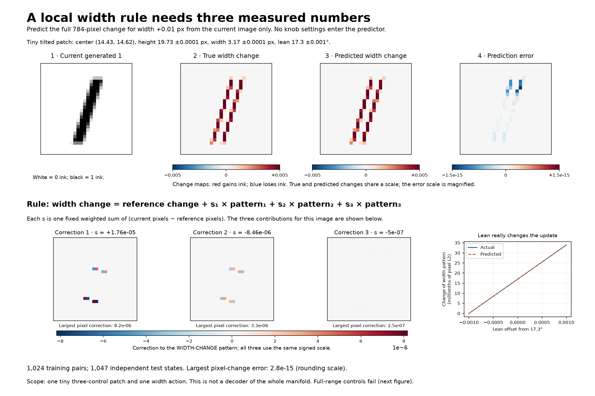
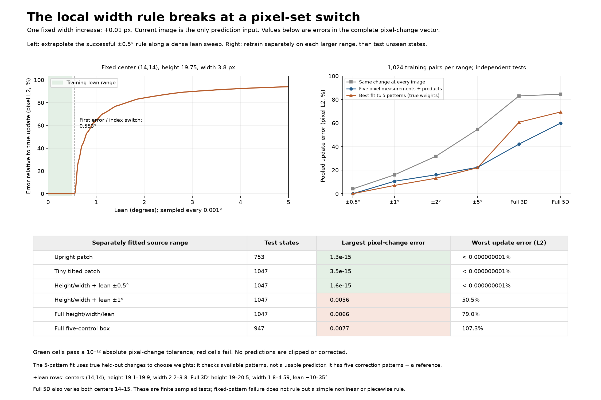

# Predicting a width update from the current image

The predictor receives 784 pixel values and fixed fitted arrays. It predicts the complete pixel change for **width +0.01 px**. It receives no current control settings and does not call the renderer, detect edges, or invert the generator.

**Result:** an affine rule compresses to a reference change plus three weighted patterns in a tiny tilted patch, matching all tested updates to rounding precision. A larger height/width patch remains accurate with lean from -0.5 to +0.5 degrees. Widening the lean range breaks the single global polynomial rule. Five fixed correction patterns are also insufficient across the full height/width/lean slice.





## The rule

```text
measured numbers = (current image - reference image) @ reader
predicted width change = reference change + measured numbers @ patterns
```

Every column of `reader` is an explicit 784-number pixel-weight vector. Every row of `patterns` is an explicit 784-number correction to the width-change pattern. In the tiny tilted patch, there are three readers and three patterns. The values of those readers are useful for predicting this action; they are not claimed to be three coordinates that decode the whole image.

The uncompressed comparison uses at most five linear measurements of the image and an explicit degree-two polynomial in them: one constant, five linear terms, and fifteen pair products including squares. Its output has at most 21 stored pixel patterns. The five measurements are selected by an SVD of training source images; no variance-retention claim is used to justify accuracy. All reported accuracy is measured against independent renderer outputs.

## Training and information boundaries

Each domain uses 1,024 scrambled Sobol training sources and their paired width-updated images (2,048 renderer images). Training sees source vectors and labeled-action change vectors only. Physical settings are used by the adapter to create data and by the checker to create fresh answers. All arrays are float64, using the original `grey_ones.render` coverage calculation before float32 storage.

Test sources combine 512 new Sobol states, a lattice including corners, 128 near-box-face states, and 64 independent states selected for a large forward/backward width second difference. Screening candidates are never used for fitting. No test source equals any training source. Hard-case screening uses true renderer data for evaluation selection, not for prediction.

Width sources in the full-range cases end at 4.59 so that the +0.01 target stays within the default 4.6 bound. Other default bounds are unchanged. Centers are fixed at (14,14) except for the explicitly tilted local patch and full-five control.

## Results

| Case | Tests | Compact affine correction patterns | Quadratic pooled L2 error | Quadratic worst L2 error | Largest pixel error |
| --- | ---: | ---: | ---: | ---: | ---: |
| Upright patch | 753 | 1 | 1.764e-11% | 2.565e-11% | 1.28e-15 |
| Tiny tilted patch | 1047 | 3 | 1.472e-11% | 3.847e-11% | 3.45e-15 |
| Add lean ±0.5° | 1047 | 1 | 1.52e-11% | 3.137e-11% | 1.59e-15 |
| Full height/width/lean | 1047 | 5 | 42.12% | 78.96% | 0.00662 |
| All five controls | 947 | 5 | 59.95% | 107.3% | 0.00772 |
| Lean ±1° | 1047 | 5 | 10.53% | 50.49% | 0.00564 |
| Lean ±2° | 1047 | 5 | 16.03% | 54.97% | 0.00529 |
| Lean ±5° | 1047 | 5 | 22.35% | 50.79% | 0.0044 |

Pooled error is the norm of all update errors divided by the norm of all true updates. Worst error is the largest individual ratio. Neither is a percentage of correct pixels. The comparison across full cases includes a much broader domain and different dimensions; it is not a uniform scale sweep.

## Positive controls

The preceding four-image upright formula was newly checked against 1,024 independently rendered states. Its image-derived pixel reader predicted width changes with largest pixel error 1.03e-15, and reconstructed current images with largest pixel error 1.44e-15. Those are new renderer checks, not just values synthesized by the fitted formula.

The tiny tilted patch has source affine rank 5 and width-change affine rank 3 at the recorded thresholds. Compressing its affine predictor to three correction patterns gives largest held-out pixel error 2.82e-15. Varying lean alone genuinely changes the width-update vector by L2 3.39e-05; this success is not explained by an unchanged target.

In the wider upright height/width patch with lean +/-0.5 degrees, the width-update pattern is unchanged by lean within numerical accuracy. Its exact prediction is therefore an easier success than the tilted local result. It needs just one correction pattern tracking the height-dependent cap contribution.

The estimated affine ranks describe the sampled arrays, not intrinsic dimension. Source singular values use threshold `max(largest*1e-12, 1e-12)`; change singular values use `max(largest*1e-10, 1e-12)`. An absolute floor excludes cancellation-level directions in the very small tilted patch.

## Where the local rule first fails

A dense lean sweep fixes center (14,14), height 19.75, and width 3.8. The +/-0.5-degree compact rule stays below 1e-12 maximum pixel error through 0.552 degrees; the first failing sampled state is 0.553 degrees. The set of actually changing pixels first changes at 0.553 degrees. Resolution is 0.001 degree, so these are sampled event locations, not exact analytic thresholds.

Retraining on wider lean ranges still fails, so this is not just reuse of an out-of-range fitted model. At +/-1 degree the quadratic rule has about 10.5% pooled error and 50.5% worst-update error. Generic pairwise products of five image measurements do not handle the newly changing pixel regimes at this budget.

## Pattern capacity versus predicting weights

For each domain, a separate diagnostic factors the training width-update vectors into shared patterns. On held-out updates it projects the true change into those patterns, giving their best attainable weights. This is not an inference algorithm: true target values are used. Across the full three-control slice, five correction patterns plus a reference still leave about 60.7% pooled error. Even a perfect nonlinear rule for those five weights could not remove that residual while keeping these same patterns.

This result does not prohibit a compact five-coordinate nonlinear decoder. A simple function can move which pixel indices participate and consequently have a large global linear span. Piecewise rules or a nonlinear representation that changes the patterns themselves remain possibilities.

The full affine image predictor is included as a diagnostic. It can extrapolate badly near sparsely observed box corners, particularly in the all-five case. Increasing the number of input patterns without a suitable state rule is not a cure; these results do not establish its best possible sample efficiency.

## Verification and limits

`verification.json` records exact re-rendering of every saved test source and target, recomputed metrics, and loading/evaluating each compact model. `results.json` includes pixel-order permutation invariance, separate test-group scores, singular values in the saved model files, and best-fit pattern counts. Predictions are not clipped; verification records targets that leave [0,1].

The main accuracy results use float64 coverage. As a storage control, the already fitted compact rules were also given default float32-rendered inputs and compared with float32-rendered targets. Largest pixel errors were 5.48e-08 in the upright patch, 5.92e-08 in the tiny tilted patch, and 5.78e-08 in the narrow-lean patch. Quantized input/target values cannot support the float64 rounding-scale claim.

Only the positive width action of +0.01 px was fitted. This is a finite-action predictor, not an instantaneous derivative, a general step-size integrator, a global manifold-membership rule, or a five-coordinate decoder. No neural networks, shape features, or recovered physical settings are used at inference. A finite set of successful samples does not certify every point in a patch.

The next targeted question is how to discover the switches between local image-to-change rules from numeric vectors. The failures identify a useful target for that work; they do not prove that a small exact global rule exists or cannot exist.

## Reproduce

```bash
OPENBLAS_NUM_THREADS=1 .venv/bin/python experiments/image_only_width_field.py
OPENBLAS_NUM_THREADS=1 .venv/bin/python experiments/report_image_only_width_field.py
```
