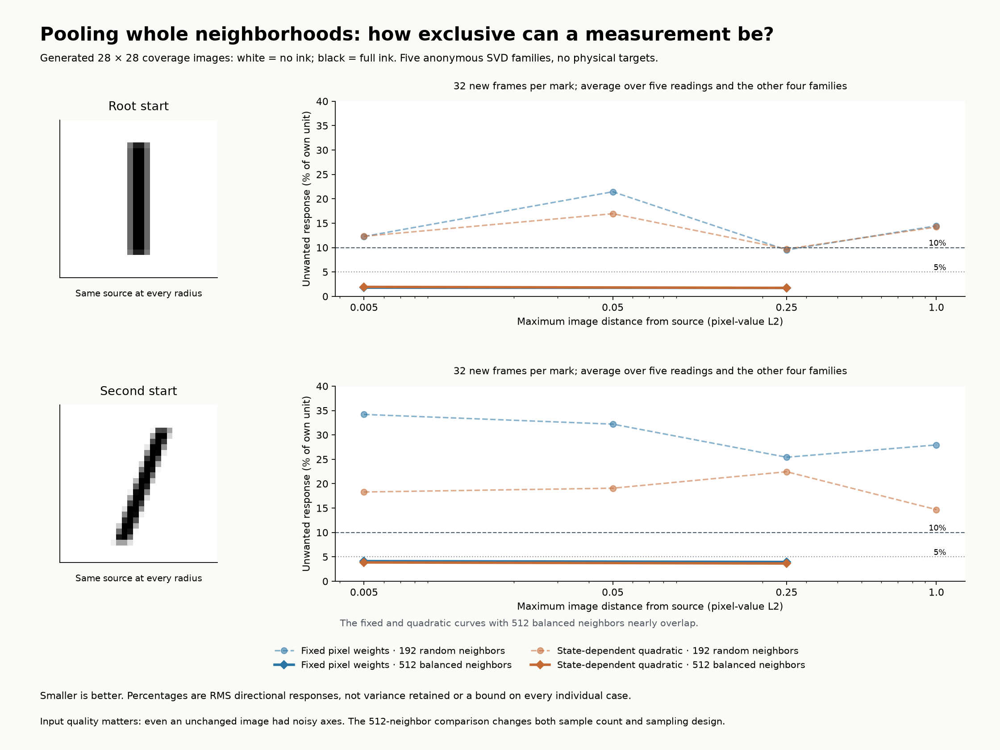
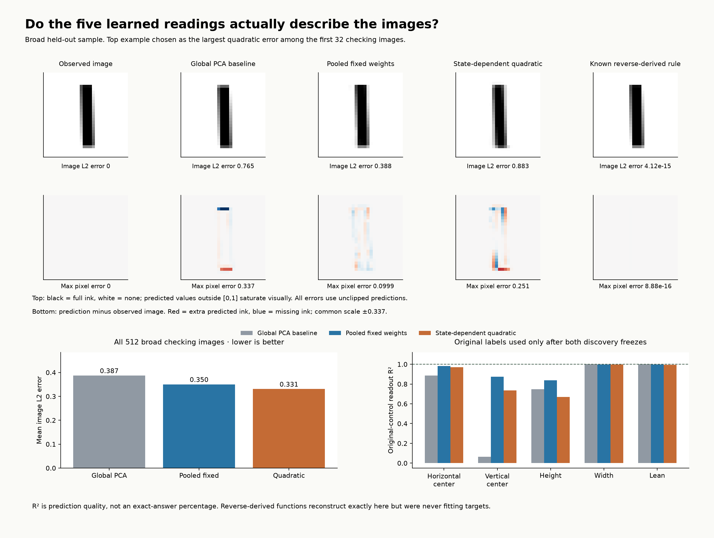

# Pooled perpendicular readings with explicit tolerance

**Result: pooling is straightforward linear algebra and works locally with sufficiently stable inputs. A fixed perpendicular vector is not guaranteed to exist even when a nonlinear coordinate does. The broad five-knob family remains unsolved by this discovery procedure.**

## What was tested

The measurement is a scalar function of the 784 image values. Its gradient, not the movement vector itself, should be perpendicular to the other families. Stack all fitting-state constraints together: one calibrated mean response to the target family and small responses to the other four. This solves the whole area jointly, not one vector at a time. Zero or unresponsive readings are excluded.

Two fixed-weight methods were compared: a minimum-gradient-norm common-nullspace solve with explicit RMS bounds; and a pooled derivative least-squares fit that also controls variation of the own-family response. State-dependent alternatives fit scalar quadratic, cubic, and Gaussian-kernel functions to the same derivative constraints. These are gradient-informed fits with explicit scalar potentials; we do not assign unrelated gradients independently at every image.

All data-varying raw pixel columns are kept in the linear part. Nonlinear features are generic functions of 8 or 12 image PCs. Penalties measure gradient size in original pixel units. No old edge/center/width readers, original coordinate values, analytic physical directions, or rendering formulas enter fitting or selection. The original controls still generate observations, so acquisition has a simulator sampling prior.

Method references: [least-squares mathematics](https://www.seas.ucla.edu/~vandenbe/133A/lectures/ls.pdf) and [gradient-augmented approximation](https://arxiv.org/abs/1712.06645). Our implementation uses regularized derivative least squares, not the latter paper's sparse recovery algorithm.

## What tolerance means

The explicit requested bounds are 1%, 3%, 5%, 10%, 20%, 30%, 50%, and 100% RMS unwanted response, relative to a mean own-family response normalized to one. The bound is imposed on the fitting frames. Validation and new-frame errors are measured independently; an infeasible bound is reported as infeasible. An average bound is not a worst-state guarantee. This is response tolerance, not retained variance or an image reconstruction tolerance.

Relaxation is encoded directly in the spectral/constrained solve. No manual nudging of pixels or directions is needed. A separate diagnostic computes the state-specific mixing of the five supplied vectors needed for perfectly separated responses, and records its rotation angles and speed changes. That algebraic correction alone is not a global-coordinate certificate.

## Curved-coordinate control

Consider a two-number state with x = u and y = v + u squared. The coordinate v equals y minus x squared. Its measurement gradient is (-2x, 1), which changes with the state. No nonzero fixed vector is perpendicular to all u-directions (1, 2u) while also measuring v. The fitted quadratic reading recovers this rule to numerical precision; the fixed readout retains 116.6% RMS unwanted response after unit calibration.

This is a direct example where the coordinate exists but a search for one constant perpendicular vector cannot find it. It is a separate mathematical control, not a feature supplied to the image learner.

## The input directions themselves have sampling noise

At each of two unchanged source images, compare repeated independent neighborhood fits. Pool the largest balanced-neighborhood covariances for reference axes, without physical labels.

| Acquisition | Root median axis rotation | Second-start median axis rotation | Root unwanted response | Second-start unwanted response |
| --- | ---: | ---: | ---: | ---: |
| 192 random neighbors | 7.19° | 9.61° | 9.49% | 13.97% |
| 512 balanced neighbors | 0.87° | 1.84° | 1.78% | 4.12% |
| 2048 balanced neighbors | 0.31° | 0.49° | 0.36% | 1.15% |

The fitted five-dimensional spaces are much more stable than individual axes (mean projection residuals about 1e-6 or less). Thus family-axis wobble is present even when the state does not change. The first comparison changes both sample count and sampling design; 512 versus 2048 keeps the balanced design. These are finite-sample controls, not universal noise bounds.

The follow-up re-estimates frames at the exact same patch states using 512 balanced neighbors and repeats fitting without changing the image sets. It was triggered by blind response scatter, before physical evaluation. Both runs are kept and separately frozen.

## Patch results with cleaner inputs

| Source | Maximum image distance | Method | Unwanted response | Own-response variation | Mean image L2 error | Median correction angle |
| --- | ---: | --- | ---: | ---: | ---: | ---: |
| 0 | 0.005 | Fixed pooled | 1.79% | 0.16% | 1.46e-10 | 0.82° |
| 0 | 0.005 | State-dependent quadratic | 1.95% | 0.44% | 2.39e-09 | 0.88° |
| 0 | 0.25 | Fixed pooled | 1.74% | 0.15% | 4.88e-07 | 0.85° |
| 0 | 0.25 | State-dependent quadratic | 1.74% | 0.18% | 5.72e-07 | 0.86° |
| 1 | 0.005 | Fixed pooled | 4.12% | 0.77% | 9.56e-07 | 1.04° |
| 1 | 0.005 | State-dependent quadratic | 3.86% | 0.78% | 9.94e-07 | 1.40° |
| 1 | 0.25 | Fixed pooled | 3.95% | 0.72% | 0.000341 | 1.80° |
| 1 | 0.25 | State-dependent quadratic | 3.65% | 0.85% | 0.000353 | 1.38° |

Each mark uses 32 new frames, with all five readings checked against the four non-target families. Image reconstruction is checked on 256 different images. Mean image error and family selectivity are separate criteria. Small response error does not itself prove a one-to-one global representation.

## Broad-family results

| Method | Unwanted response | Own-response variation | Mean held-out image L2 error | Worst pixel error |
| --- | ---: | ---: | ---: | ---: |
| Five global PCs | 962.2% | 297.7% | 0.3872 | 0.7513 |
| Common-nullspace constraint | 54.1% | 99.6% | 0.3367 | 0.3931 |
| Fixed derivative fit | 52.4% | 95.5% | 0.3503 | 0.6131 |
| Quadratic derivative fit | 49.2% | 88.6% | 0.3308 | 0.8116 |
| Cubic derivative fit | 45.5% | 83.1% | 0.3817 | 0.7065 |
| Kernel derivative fit | 45.7% | 77.2% | 0.4650 | 1.1721 |

The broad quadratic readout improves mean image reconstruction over the global-PC baseline, but remains an approximation. Own-family response and direction identity vary substantially. The kernel method has a severe instability in the branch scope: its held-out gradient and response norms explode despite good-looking image interpolation. This failure is retained; smooth scalar functions and a training gradient penalty alone do not guarantee stable extrapolation.

Ordinary PCA and SVD were both tested throughout. The files retain every result, threshold, regularization candidate and validation choice. No general PCA advantage is established.

## Comparison to the reverse-derived coordinates

Original settings and known image readers were evaluated only after both discovery freezes verified. Maps from discovered readings to original controls used training labels and validation degree selection, then untouched checking labels.

| Broad readout | Horizontal center R² | Vertical center R² | Height R² | Width R² | Lean R² |
| --- | ---: | ---: | ---: | ---: | ---: |
| Global PCs | 0.8871 | 0.0630 | 0.7470 | 0.9997 | 0.9999 |
| Fixed pooled | 0.9832 | 0.8749 | 0.8382 | 0.9982 | 0.9988 |
| Quadratic pooled | 0.9706 | 0.7359 | 0.6704 | 0.9960 | 0.9949 |

R² is explained variation on new labels, not a percentage of exact answers. Known reverse-derived readers reconstruct this family to numerical precision. Their responses to the supplied SVD axes need not be exclusive: those axes can mix physical controls. On actual original physical directions, the known readers have the identity response matrix. This distinction prevents treating imperfect raw-family exclusivity as proof that a valid intermediate coordinate does not exist.

The cleaner local fixed readings also map very accurately to all five original controls. These maps were fitted only after the readings were frozen:

| Source | Radius | Lowest R² among five controls | Largest pixel-control RMS error | Lean RMS error (degrees) |
| --- | ---: | ---: | ---: | ---: |
| 0 | 0.005 | 1.0000000000 | 1.83e-11 | 4.4e-10 |
| 0 | 0.25 | 1.0000000000 | 3.5e-08 | 7.38e-07 |
| 1 | 0.005 | 0.9999999975 | 2.86e-08 | 1.39e-07 |
| 1 | 0.25 | 0.9999993502 | 1.75e-05 | 0.00011 |

The four pixel controls are horizontal center, vertical center, height and width. The local discovered readings are explicit fixed linear functions: a learned 5-by-784 matrix applied to the state plus five constants. The original settings are then approximated by a selected cubic polynomial of those five readings. They are useful local intermediate coordinates, not individually pure original knobs.

Actual coefficients are in `functions/`: each `patch_*_readings.csv` contains five pixel-weight rows plus offsets; each `patch_*_post_freeze_map.json` specifies the normalization, polynomial terms and original-control coefficients. No previous shape-reader formula enters those measurements.

## Scope, integrity, and limits

The primary comparison uses two existing scopes and eight new image-distance balls around two starts. Each new patch has 1,536 training images, 256 validation images, 256 checking images, and 96/32/32 separate frame states. The primary frame fit has 192 neighbors at radius 0.0001. New frame states are independent; the primary acquisition reuses its random-ray design by frame index across splits. The balanced comparison uses independent scrambled designs across splits. Root patches are two-sided and can extend beyond the default position bounds.

Discovery selection uses validation image reconstruction only; directional errors and conditioning are reported separately, including cases that fail. Each final decoder is selected among five fixed local-polynomial choices and retains its training examples. It is an interpolation diagnostic, not a compact exact image equation.

The scalar readings have route-independent values by construction. Closed-triangle gradient quadrature is a numerical consistency check in ambient image space, not a test that the original vector-family flows commute. The rotation diagnostic remains pointwise. No globally covering atlas or globally exact discovery is claimed.

The broad-family comparison retains the 192-random-neighbor inputs. The cleaner 512-neighbor repeat covers four patches only. A broad repeat with cleaner frames remains untested, so this run does not separate all global geometric limitations from acquisition error.

Frozen hashes, blocked-read checks and saved-function response spectra pass. Finite-difference derivative checks report 0 numerical failures out of 136; the individual results remain in verification.json.

The useful next target is stable local scalar coordinates with explicit overlap transitions, cleaner direction estimates, and reconstruction constraints. The tests do not support requiring one fixed global perpendicular pixel vector per raw SVD family.

## Saved evidence

- `PROTOCOL.md` and `QUALITY_CONTROL.md` in the experiment source directory: the pre-fit contracts.
- `FREEZE.json` and `BALANCED_FREEZE.json`: source/input/model hashes before physical evaluation.
- `blind_results.json` and `balanced_results.json`: every blind attempt and selected model.
- `stationary_quality.json`: repeated fits at unchanged images.
- `blind_rotation_diagnostic.json` and `balanced_rotation_diagnostic.json`: direction mixing required for exclusive readings.
- `physical_evaluation.json`: post-freeze physical maps and known-reader controls.
- `models.npz` and `balanced_models.npz`: fixed coefficients for the scalar functions.
- `verification.json`: saved-function and finite-difference checks.

Sources are under `experiments/pooled_family_coordinates/`. All document and artifact paths are repository relative.
