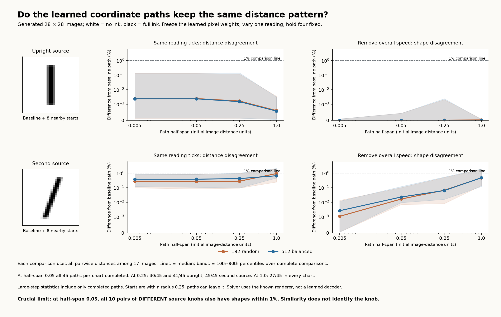

# What the frozen learned readings actually do

**Result: the learned coordinates have very similar local path distances across nearby starts, but different coordinates also have nearly identical distance signatures. Distance agreement is not a unique knob identifier.**

This evaluates the actual 192-random and 512-balanced fixed pixel readings from the radius-0.25 patches. It does not substitute the reverse-engineered top/bottom/slope coordinates. All existing frozen files were checked unchanged.

## How a path was defined

At each of nine starts (the source and the first eight held-out frame states), change one frozen scalar reading and hold the other four fixed. Solve the five equations on the known generated-image family. The renderer and derivative are evaluation tools here, not a discovered inverse model. Each path has 17 samples. Both signs are followed by continuation.

Shared reading ticks are calibrated once for each coordinate at the chart source to unit initial pixel speed. The alternative calibration normalizes initial speed separately at each start. Shape-only comparison divides each complete pairwise-distance matrix by its norm. This distinguishes consistent distances from similarities manufactured by rescaling.

## Measured distance agreement

| Acquisition / source | Half-span | Complete paths | Median distance-matrix difference | Maximum difference | Median shape-only difference |
| --- | ---: | ---: | ---: | ---: | ---: |
| 192_random_source_0 | 0.005 | 45/45 | 0.00243053% | 0.181753% | 4.41065e-07% |
| 192_random_source_0 | 0.05 | 45/45 | 0.00243059% | 0.181732% | 4.41067e-06% |
| 192_random_source_0 | 0.25 | 40/45 | 0.00165787% | 0.181699% | 1.1933e-05% |
| 192_random_source_0 | 1 | 27/45 | 0.000606912% | 0.00950277% | 3.34443e-05% |
| 192_random_source_1 | 0.005 | 45/45 | 0.274333% | 1.14154% | 0.00107954% |
| 192_random_source_1 | 0.05 | 45/45 | 0.265582% | 1.1104% | 0.0165824% |
| 192_random_source_1 | 0.25 | 45/45 | 0.276444% | 1.22168% | 0.0664698% |
| 192_random_source_1 | 1 | 27/45 | 0.926241% | 2.10922% | 0.472254% |
| 512_balanced_source_0 | 0.005 | 45/45 | 0.00234249% | 0.187278% | 1.97946e-07% |
| 512_balanced_source_0 | 0.05 | 45/45 | 0.00234255% | 0.187419% | 1.97905e-06% |
| 512_balanced_source_0 | 0.25 | 41/45 | 0.00150651% | 0.187389% | 8.01269e-06% |
| 512_balanced_source_0 | 1 | 27/45 | 0.00057606% | 0.00836438% | 1.24522e-05% |
| 512_balanced_source_1 | 0.005 | 45/45 | 0.378488% | 1.18852% | 0.00261815% |
| 512_balanced_source_1 | 0.05 | 45/45 | 0.379986% | 1.31771% | 0.022897% |
| 512_balanced_source_1 | 0.25 | 45/45 | 0.417839% | 1.37595% | 0.0633902% |
| 512_balanced_source_1 | 1 | 27/45 | 0.656206% | 2.19841% | 0.476866% |

There are five reference paths and up to 40 reference-to-held-out comparisons per chart. At half-span 0.05 every path completed. The largest distance differences were 0.18–0.19% at the upright patch and 1.11–1.32% at the second patch. The balanced run is not uniformly better on this path metric. Counts and sampling design both changed.

At half-spans through 0.25, every pair of different source-coordinate paths also has shape-only distance difference below 1% in all four charts. Almost straight paths at comparable speed naturally have almost identical distances, even if they change different original controls. This is a concrete counter-control to using distance similarity alone for family identity.

At half-span 1, 18 of 45 paths per chart did not complete to the coordinate-residual requirement. Incomplete paths are saved. This is a continuation failure, not proof that every requested coordinate target is mathematically impossible. Surviving-path statistics must not be interpreted as full-chart success. Some smaller paths also leave the radius-0.25 training ball. Default parameter bounds are not imposed, consistent with the original two-sided root patches; positive stroke size and full containment on the canvas are required.

The same frozen pixel chart can also lose rank at the other distant source:
- 192_random_source_0: derivative rank 3 of 5 at the other source.
- 192_random_source_1: derivative rank 4 of 5 at the other source.
- 512_balanced_source_0: derivative rank 3 of 5 at the other source.
- 512_balanced_source_1: derivative rank 4 of 5 at the other source.

## The actual original-knob mappings

These are post-freeze maps of the learned readings, not geometric readers supplied to discovery. A standardized reading subtracts its training mean and divides by its training standard deviation. The original controls are standardized the same way. Thus the matrices below compare effects on comparable scales, without mixing pixels with degrees.

Each matrix maps the five standardized readings to standardized original controls. It is the best linear fit on the original training set. The full cubic fit is a better approximation and uses squares, pairwise products and cubic terms of all five readings. Exact means, scales, every polynomial coefficient, and held-out errors are in `results.json` under each chart mapping.

### 192_random_source_0

| Original control | Reading 1 | Reading 2 | Reading 3 | Reading 4 | Reading 5 |
| --- | ---: | ---: | ---: | ---: | ---: |
| horizontal_center | -0.0042 | +0.0138 | -1.0002 | +0.0018 | -0.0011 |
| vertical_center | +0.0036 | -0.0043 | +0.0042 | +0.9949 | +0.0447 |
| height | +0.0044 | +0.0135 | -0.0051 | -0.0874 | +1.0049 |
| width | -0.0016 | +0.9983 | +0.0078 | +0.0038 | -0.0381 |
| lean_degrees | +1.0000 | +0.0005 | -0.0001 | -0.0002 | -0.0002 |

| Original control | Linear held-out RMS error | Cubic held-out RMS error |
| --- | ---: | ---: |
| horizontal_center | 1.38092e-05 | 3.46497e-08 |
| vertical_center | 8.76846e-05 | 7.15132e-09 |
| height | 0.000130109 | 1.01119e-08 |
| width | 2.11639e-05 | 1.60963e-09 |
| lean_degrees | 0.000665658 | 7.37614e-07 |

Position/height/width errors are in pixels; lean errors are in degrees. These maps use original labels after discovery. Near-perfect cubic interpolation locally is not a compact exact global manifold equation.

### 192_random_source_1

| Original control | Reading 1 | Reading 2 | Reading 3 | Reading 4 | Reading 5 |
| --- | ---: | ---: | ---: | ---: | ---: |
| horizontal_center | -0.1881 | +0.8665 | -0.0125 | +0.4481 | -0.0162 |
| vertical_center | -0.0650 | +0.3241 | -0.0159 | -0.9620 | +0.0284 |
| height | -0.0007 | -0.0007 | -0.0070 | +0.0326 | +0.9969 |
| width | +0.9772 | +0.1477 | -0.0013 | -0.0128 | -0.0172 |
| lean_degrees | +0.0016 | -0.0029 | +1.0000 | -0.0052 | -0.0032 |

| Original control | Linear held-out RMS error | Cubic held-out RMS error |
| --- | ---: | ---: |
| horizontal_center | 0.000199735 | 8.47265e-06 |
| vertical_center | 0.000552816 | 1.20484e-05 |
| height | 0.00106179 | 2.39643e-05 |
| width | 0.000174201 | 1.77849e-05 |
| lean_degrees | 0.000707317 | 0.000107817 |

Position/height/width errors are in pixels; lean errors are in degrees. These maps use original labels after discovery. Near-perfect cubic interpolation locally is not a compact exact global manifold equation.

### 512_balanced_source_0

| Original control | Reading 1 | Reading 2 | Reading 3 | Reading 4 | Reading 5 |
| --- | ---: | ---: | ---: | ---: | ---: |
| horizontal_center | +0.0011 | +0.0019 | -1.0001 | -0.0004 | +0.0000 |
| vertical_center | +0.0009 | -0.0015 | -0.0020 | +1.0001 | -0.0036 |
| height | +0.0004 | +0.0237 | +0.0009 | +0.0061 | +1.0000 |
| width | -0.0002 | +0.9982 | +0.0010 | -0.0001 | -0.0385 |
| lean_degrees | +1.0000 | -0.0000 | +0.0002 | -0.0001 | -0.0001 |

| Original control | Linear held-out RMS error | Cubic held-out RMS error |
| --- | ---: | ---: |
| horizontal_center | 1.37007e-05 | 3.49837e-08 |
| vertical_center | 8.73194e-05 | 6.97772e-09 |
| height | 0.000129931 | 1.01469e-08 |
| width | 2.11507e-05 | 1.55187e-09 |
| lean_degrees | 0.000665592 | 7.37585e-07 |

Position/height/width errors are in pixels; lean errors are in degrees. These maps use original labels after discovery. Near-perfect cubic interpolation locally is not a compact exact global manifold equation.

### 512_balanced_source_1

| Original control | Reading 1 | Reading 2 | Reading 3 | Reading 4 | Reading 5 |
| --- | ---: | ---: | ---: | ---: | ---: |
| horizontal_center | -0.8793 | -0.0006 | -0.0012 | +0.0197 | +0.4435 |
| vertical_center | -0.3093 | -0.0023 | -0.0012 | -0.0319 | -0.9633 |
| height | -0.0002 | +0.0107 | -0.0049 | -0.9973 | +0.0408 |
| width | -0.0039 | +0.9997 | -0.0045 | +0.0182 | -0.0142 |
| lean_degrees | +0.0041 | -0.0004 | +0.9999 | +0.0032 | -0.0049 |

| Original control | Linear held-out RMS error | Cubic held-out RMS error |
| --- | ---: | ---: |
| horizontal_center | 0.000138104 | 8.87364e-06 |
| vertical_center | 0.000342407 | 1.07879e-05 |
| height | 0.00048503 | 1.59304e-05 |
| width | 0.000220601 | 1.75351e-05 |
| lean_degrees | 0.000815912 | 0.000110299 |

Position/height/width errors are in pixels; lean errors are in degrees. These maps use original labels after discovery. Near-perfect cubic interpolation locally is not a compact exact global manifold equation.

## PCA of changes within each vector family

Fit PCA to centered, sign-aligned training direction vectors in each family. Use held-out states for vector approximation errors. The variation includes curvature, family matching errors and finite-neighborhood sampling noise. PCA is not told which source causes it.

| Acquisition / source | Family | PCs for 95% training variation | Mean-only checking vector error | With 2 PCs | With 5 PCs |
| --- | ---: | ---: | ---: | ---: | ---: |
| 192_random_source_0 | 1 | 4 | 0.04206 | 0.0139015 | 0.00351158 |
| 192_random_source_0 | 2 | 3 | 0.132923 | 0.0405322 | 0.00385517 |
| 192_random_source_0 | 3 | 3 | 0.139191 | 0.0420601 | 0.00465199 |
| 192_random_source_0 | 4 | 3 | 0.20215 | 0.0762549 | 0.0175018 |
| 192_random_source_0 | 5 | 3 | 0.192509 | 0.0588491 | 0.0162953 |
| 192_random_source_1 | 1 | 2 | 0.513861 | 0.0953713 | 0.0594052 |
| 192_random_source_1 | 2 | 2 | 0.512814 | 0.0931395 | 0.0560736 |
| 192_random_source_1 | 3 | 5 | 0.130795 | 0.0620701 | 0.0250341 |
| 192_random_source_1 | 4 | 2 | 0.41508 | 0.0755586 | 0.030351 |
| 192_random_source_1 | 5 | 2 | 0.411555 | 0.0679385 | 0.0307418 |
| 512_balanced_source_0 | 1 | 4 | 0.00721154 | 0.00343825 | 0.000710712 |
| 512_balanced_source_0 | 2 | 3 | 0.0130978 | 0.00655721 | 0.00247729 |
| 512_balanced_source_0 | 3 | 3 | 0.0165469 | 0.00759997 | 0.00125111 |
| 512_balanced_source_0 | 4 | 2 | 0.0627676 | 0.0143195 | 0.00523099 |
| 512_balanced_source_0 | 5 | 3 | 0.0616267 | 0.0164865 | 0.00527951 |
| 512_balanced_source_1 | 1 | 5 | 0.101382 | 0.0470922 | 0.0222686 |
| 512_balanced_source_1 | 2 | 4 | 0.101535 | 0.0453091 | 0.0193005 |
| 512_balanced_source_1 | 3 | 3 | 0.12479 | 0.0366313 | 0.0169142 |
| 512_balanced_source_1 | 4 | 2 | 0.117899 | 0.0255158 | 0.0114308 |
| 512_balanced_source_1 | 5 | 2 | 0.11939 | 0.0259784 | 0.0105357 |

Direction vectors have length one; checking errors are mean Euclidean errors in the full 784-dimensional direction, not original-knob accuracies. A family mean plus a few changing patterns can compress its observed direction variation. This does not give the state-dependent coefficients of those patterns, independent coordinates, or an image decoder.

## Applying PCA repeatedly

Applying PCA again to the full PCA scores changed the singular-value spectrum by relative error 3.47e-16. It produced no new information. Once PCA has decorrelated the data, an unchanged second pass retains the same principal directions up to signs, ordering and rotations within equal-variance spaces. Truncation can remove information but cannot recover new structure by repetition.

A different question is PCA on a collection of direction vectors from many states; that changes the dataset to the variation of the directions and is what the family experiment above tests. Centered PCA on just five orthonormal basis vectors at a single state instead has four equal nonzero singular values. That result follows from their orthonormality, not the manifold having four knobs.

## Tangent combinations versus finite moves

At a smooth state where five original control derivatives are independent, every alternative coordinate direction is a linear combination of those five derivatives at that state. A nonlinear coordinate transformation makes the combination coefficients depend on the state. A finite displacement along the resulting curved path need not lie in the starting tangent plane. Nonlinear coordinate maps and local linear combinations are compatible.

## Verification and artifacts

- Independent renderer agreement: maximum difference 0.
- Analytic evaluation Jacobian versus central differences: maximum relative error 1.86e-08.
- Saved valid paths: other-reading drift below 1.77e-10 training standard deviations.
- Saved valid paths: active-reading line error below 1.21e-10 training standard deviations.
- Both original freeze manifests and all files they cover remain unchanged.
- `results.json`: full mappings, centered family PCA, all path measurements and verification.
- `summary.json`: pooled comparisons and cross-family controls.
- `paths.npz`: images, source settings, inverse solutions, residuals and actual frozen measurement matrices.
- Sources and pre-run protocol: `experiments/pooled_reading_paths/`.

