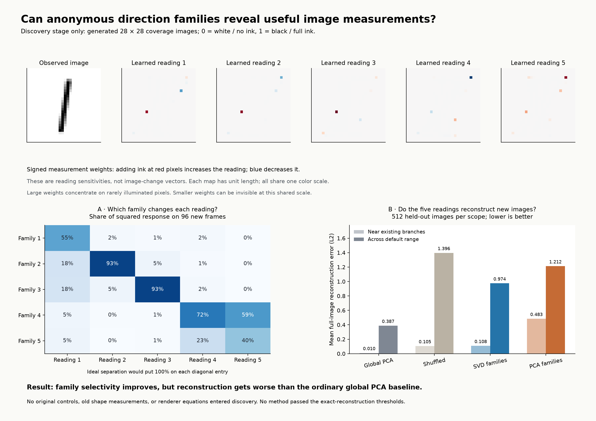
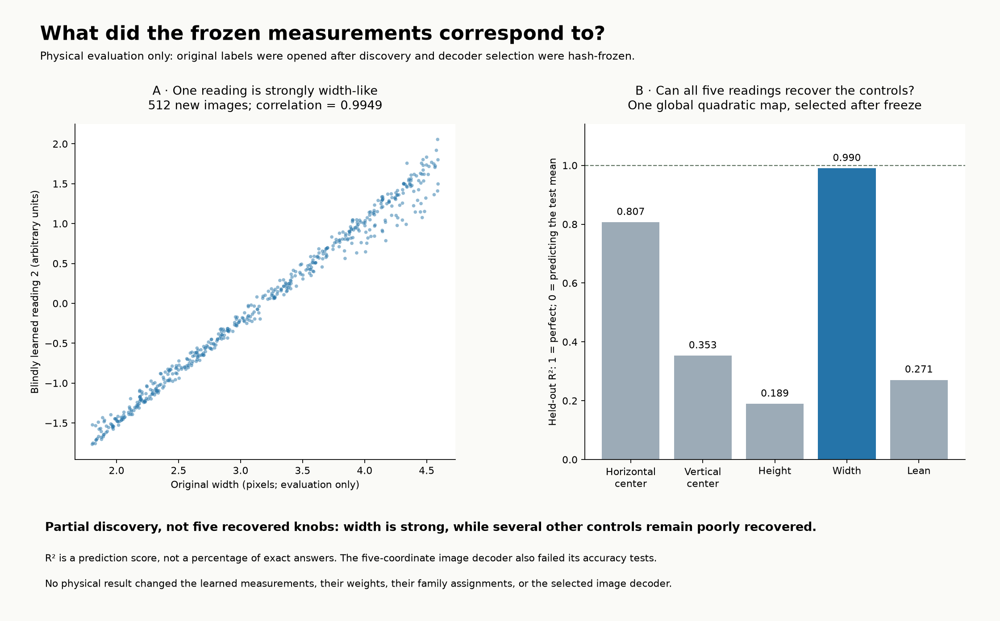

# Blind discovery from estimated SVD/PCA families

**Outcome: partial structure was recovered, but this process did not recover five reliable intermediate controls.**

One broad-sample SVD measurement was strongly width-like (correlation 0.9949), another had correlation 0.8953 with horizontal position. These meanings were checked only after all discovery outputs were frozen. The five measurements together failed image reconstruction and full original-control recovery.

## What the learner received

- Pixel arrays and five estimated direction vectors per state.
- Anonymous initial family assignments copied from the earlier distance/angle branch experiment.
- Five as the requested coordinate count.

It received no original settings, names, parameter ranges, analytic derivatives, prior edge/center readers, or renderer equations. The acquisition program used simulator controls to generate observations; its ray-sampling distribution is a prior. The designer knows this family, so this is computational information isolation, not human-level blind design.

## The discovery process

For each family, search for an image measurement whose response is strong along that family and weak along the other four. Responses come from applying the candidate measurement to the estimated pixel vectors. A generalized eigenproblem chooses the pixel weights. The criterion uses no physical target.

Candidate functions are weighted pixel readings, or a weighted pixel reading plus another weighted reading divided by total image intensity, plus a constant. This generic intensity normalization is computed from the state. The two signed masks and constant completely specify each function. No row positions, shape landmarks, centers or edge formulas are supplied.

For the selected broad SVD model, the five readings equal one fixed 5-by-784 matrix applied to the state, plus five constants. The actual coefficients are saved in [broad_svd_functions.csv](broad_svd_functions.csv): each row is one reading, pixels are flattened row by row, and the last column is its constant. These are explicit mathematical functions, although their many coefficients do not constitute a short geometric explanation.

Generic feature reduction retains 48 or 96 directions, with three regularization levels and three eigenfunction candidates per family. Validation chooses a combination of five using family selectivity and low dependence between readings. The selected broad SVD model uses only weighted pixels; the normalization option was not needed for that result.

A separately selected local polynomial decoder predicts pixels from these five readings. It retains 8,192 training images, so it is an interpolation control, not a short discovered manifold equation. A global cubic is also tested as a compactness control and fails.

## Scope

Two scopes: small fresh joint perturbations around the 66 original branch states; and the broad default family range. Each has 8,192 training images, 512 validation images, 512 new checking images, 256 training frames, 96 validation frames and 96 new checking frames. Each frame uses 192 equal-image-distance observations at radius 0.0001. Both SVD and centered PCA see identical observations. Also check 12 joint paths of 17 images and 132 extra cases per scope, including all 32 corners and 100 face cases in the broad scope. All failures are saved.

## Did the families help?

| Scope | Method | Matched-family response share | Mean held-out image L2 error | Worst pixel error |
| --- | --- | ---: | ---: | ---: |
| local | global_pc | 43.9% | 0.00974 | 0.06431 |
| local | shuffled | 17.3% | 0.10515 | 2.31249 |
| local | svd | 52.3% | 0.10766 | 0.96642 |
| local | pca | 30.1% | 0.48339 | 3.05326 |
| broad | global_pc | 51.5% | 0.38719 | 0.75126 |
| broad | shuffled | 30.3% | 1.39644 | 1.21894 |
| broad | svd | 70.4% | 0.97436 | 2.65163 |
| broad | pca | 64.5% | 1.21242 | 1.94217 |

Response share is the average share of squared directional response attributable to the assigned anonymous family, not physical-knob accuracy. The shuffled control has one fixed randomization; no statistical significance claim is made. Lower image error is better. Errors use actual coverage values and are not clipped.

The SVD-family readings are more selective than the shuffled control, but less successful at reconstructing states than the five global image PCs. Selectivity alone is therefore an inadequate discovery objective. It can favor measurements that have useful local responses but awkward scale, poor conditioning, or an insufficiently simple relationship to the full state. The observed decoder failure alone does not prove exact global coordinate collisions.

A post-freeze diagnostic identifies one concrete failure mode: for every broad SVD reading, more than 99.9% of squared pixel-weight magnitude lies on pixels illuminated in fewer than 1% of training images. The pixel maps show these isolated large weights. This is weight concentration, not the fraction of prediction caused by those pixels. Regularization in whitened feature units did not control the resulting raw pixel sensitivities. These are not yet clean, robust intermediate measurements. No refitting followed this diagnosis.

## What stays consistent in the vector families?

Applying SVD again to the vectors within each family found shared patterns. Near the original branches, 7–9 patterns per family capture 99% of training vector energy; across the broad sample this rises to 48–90. The associated mean held-out vector projection errors are about 8–9% locally and 13–16% broadly. This is compression, not a discovered state-to-direction law or proof of manifold coordinates.

The stored family labels agree with alternative nearby matches on 90.0% of comparisons near the branches and 86.3% broadly. This is a self-consistency check, not correctness against original controls. Thus the initial family concept itself is imperfect when extended. Centered PCA did not solve this problem.

## Mapping to original controls: checked after freeze

The evaluator verified hashes before first opening the private labels and verified them again afterward. It fitted linear, quadratic and cubic maps using training labels, selected degree on validation labels, and checked new labels. It also tested a less compact local quadratic mapping. None changed discovery.

A simple post-freeze one-reading map is: width in pixels approximately equals 3.186122 plus 0.802431 times reading 2. Its held-out RMS error is 0.0837 pixels, with worst error 0.4152 pixels. This is a genuine approximate mapping, not exact recovery.

| Broad SVD readings → original control | Global quadratic R² | Local quadratic R² | Global RMSE |
| --- | ---: | ---: | ---: |
| Horizontal center | 0.8066 | 0.8481 | 0.13028 |
| Vertical center | 0.3530 | 0.4704 | 0.23033 |
| Height | 0.1891 | 0.4906 | 0.39984 |
| Width | 0.9900 | 0.9977 | 0.08248 |
| Lean (degrees) | 0.2708 | 0.8289 | 10.85481 |

R² is explained variation on new labels, not an exact-answer percentage. Width is strongly recoverable, but five complete intermediate controls were not found. The ordinary global PCA baseline performs substantially better within the branch region, which prevents attributing every successful mapping to family grouping.

## What this establishes and the next change to test

There is a general, implementable starting process: use each family to learn functions that remain comparatively unchanged under the other families. It produced a genuine partial discovery without supplied geometric readers. It is not yet a general method for recovering five independent controls.

The next justified change is to make preservation of all state information and local conditioning mandatory during coordinate selection, penalize large sensitivities in raw pixel units, and use family selectivity as a secondary preference. In parallel, test family consistency more strongly before requiring one scalar per family. This follow-up has not been run or tuned using the revealed physical labels.

No method passed the fixed numerical reconstruction thresholds (maximum pixel error 2e-6 and maximum image L2 error 1e-5). No globally exact five-function description, unique physical-knob discovery, or real-data success rate is claimed.

## Evidence and reproduction

- `FREEZE.json`: hashes of the discovery source, protocol, observations, models and blind results.
- `EVALUATION_ORDER.json`: separation of discovery and physical evaluation.
- `verification.json`: hash, forbidden-read, gradient and saved-function checks.
- `blind_results.json`: every candidate selection and all blind held-out checks.
- `physical_evaluation.json`: mappings evaluated only after freeze.
- `discovered_models.npz`: actual coordinate functions and saved predictions.
- `evaluation_examples.npz`: explicit pixel masks and post-freeze predictions.

Sources are in `experiments/svd_blind_intermediates/`: run `export.py`, `discover.py`, `evaluate.py`, `verify.py`, then `report.py` with the existing Python environment. The physical-label archive is deliberately not part of the discovery inputs. All artifact paths are repository relative.
