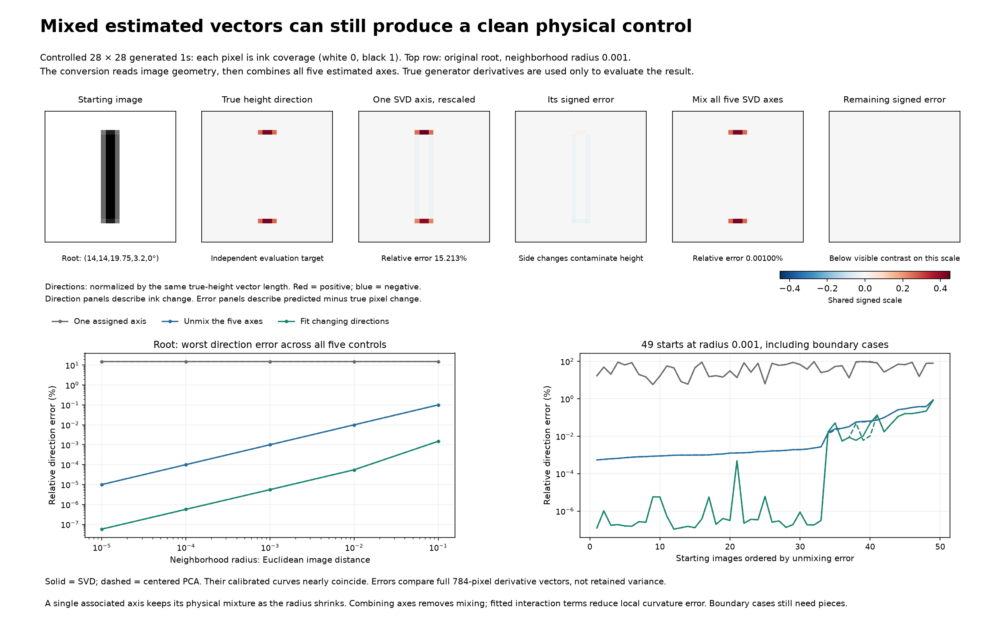
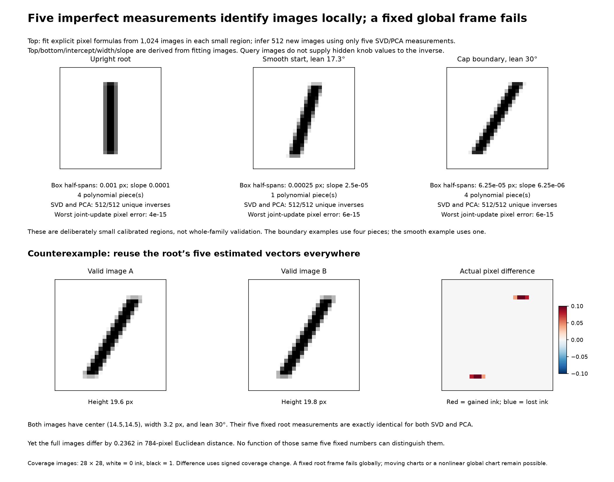

# From estimated SVD/PCA vectors to interpretable local manifold functions

**Result: the estimated vectors were clean enough to build accurate local coordinates after calibration and nonlinear correction. They did not have to be pure physical knobs. Centered PCA did not materially improve the calibrated result.**

Three deliberately calibrated local regions, including a tilted boundary, supported a unique inverse from five estimated measurements and image reconstruction/joint original-knob actions at numerical precision. This is a local construction assisted by the previously derived image measurements. It does not discover those measurements automatically or establish a compact atlas for the entire family.

## What entered the method

- Actual estimated basis vectors from ordinary local SVD or centered PCA; no true derivative vectors were substituted.
- Observed 784-value images in the neighborhoods.
- The explicit state functions from the prior experiment: top, bottom, centerline intercept, width, and slope. They receive pixels, not supplied current physical settings.
- The established fact that this renderer is quadratic in those five quantities inside a fixed overlap formula cell, and its known cap/subrow boundaries.

Known physical settings and analytic renderer derivatives generate observations and evaluate accuracy. Analytic derivatives initialize image-distance sampling; measured image distances determine the actual samples. Neither true derivatives nor original settings are targets for the calibration or polynomial decoder fits. State-derived geometric values are calibration targets.

## Experiment 1: can mixtures of estimated axes recover original controls?

At each source image, measure how each estimated axis changes all five observable physical quantities. This gives a small five-by-five conversion matrix. Inverting it gives the combination of the five axes needed for a pure horizontal, vertical, height, width, or lean action. No bucket name or matching permutation is required by this conversion.

One associated vector still mixes physical effects. A weighted combination can remove the mixture, even though true physical directions are not mutually perpendicular. A correctly assigned bucket is therefore an initial category, not a finished physical knob.

The numerical check compares the reconstructed pixel vector with an independently calculated true physical derivative. Merely reproducing the desired observable readings would be insufficient because errors could lie outside those measurements.

| Root, radius 0.001 | SVD | Centered PCA |
| --- | ---: | ---: |
| One assigned height axis: relative pixel-direction error | 15.213403% | 15.210565% |
| Combine all five: height-direction error | 0.001003% | 0.001003% |

The conversion removes mixing. It cannot by itself replace curvature directions missing from the retained five-vector span. The next experiment adds those as functions of the same five coordinates.

## Experiment 2: explicit functions of the five measured coordinates

Each SVD/PCA vector becomes a fixed weighted pixel measurement relative to the source image. The five resulting numbers are candidate local coordinates. They are functions of the current state, not new external inputs.

Fit an explicit image equation using the five numbers, their squares, and their pairwise products. There are twenty nonconstant terms. The fitted coefficients are fixed signed pixel patterns. This decoder fit uses images only; it does not call the known interval-overlap image equation. A separate polynomial maps the measured coordinates to geometric state quantities and then to the original physical settings.

The inverse control test starts with an image and requested original-knob increments, predicts the required five coordinates, and evaluates the fitted image equation. The held-out target image is used only for checking.

### Scope

- 61 saved neighborhoods at 17 starts, including radii 0.1, 0.01, 0.001 and selected smaller radii.
- 32 additional starts across all five original ranges, each at radius 0.001.
- Total: 93 neighborhoods at 49 distinct starting images, each processed by both methods.
- Each frame uses 512 fitting neighbors. Each new chart uses 512 independent filled-neighborhood images and 256 independent checking images with joint changes.
- SVD and PCA receive identical images. The PCA axis fit subtracts its training mean. Its ordinary linear reconstruction adds that mean; the polynomial charts use the source image as coordinate zero.
- Two-sided local neighborhoods may extend position bounds left/up below 14, as in the source root experiments. The 32 fresh starts lie in the interior of the default five-knob box.

| Radius 0.001, 49 starts | SVD | Centered PCA |
| --- | ---: | ---: |
| Median of per-neighborhood worst joint-update errors | 0.00000073% | 0.00000073% |
| Worst joint-update error across all neighborhoods | 0.91930863% | 0.91930606% |
| Median of per-neighborhood worst original-coordinate mapping errors | 0.00000066% | 0.00000066% |

Image errors are relative to the requested image change, not the norm of the whole starting image and not retained variance. Coordinate mapping errors use original-range-normalized changes. Every case is saved, including failures.

A single quadratic does not handle every boundary. At the tilted cap-boundary start, its worst joint-update error remains around one percent at very small radii. Splitting only at top/bottom subrows fixes some cases but worsens other neighborhoods that also cross horizontal side/pixel boundaries or have too little data per piece. Those negative results remain in the archive.

## Experiment 3: can a calibrated five-coordinate chart be exact locally?

Instead of approximating the inverse coordinate conversion with another quadratic, identify the actual quadratic image equation in each local formula piece. Its coefficients come from fitting images and their measured geometric quantities. The original renderer is not used as the predictor.

Project that equation onto the five estimated SVD/PCA vectors. This produces five explicit quadratic equations relating the estimated coordinates to top, bottom, intercept, width, and slope. Invert those five equations within the calibrated local region. The returned geometric quantities then map to the original physical knobs using the previously derived formulas.

Held-out inference receives only the five estimated measurements and saved model coefficients. It does not receive the query image’s true geometry, original settings, or formula-piece label. It tries the fitted pieces and retains the unique solution satisfying the region conditions.

The straight-stroke overlap structure makes the forward equation exactly quadratic per piece. A full-rank quadratic design identifies its coefficients in exact arithmetic. A derivative bound below one after linear normalization establishes a locally one-to-one projection throughout each calibrated convex box, including across its continuous cap joins. The numerical bound checks every box corner for every polynomial piece, since each derivative is affine and its spectral norm is convex. This uses the known quadratic structure, not just finite held-out success.

| Region | Method | Polynomial pieces | Unique inverses / 512 | Worst reconstructed pixel error | Worst joint-action pixel error |
| --- | --- | ---: | ---: | ---: | ---: |
| root | SVD | 4 | 512 | 1.67e-15 | 4.33e-15 |
| root | PCA | 4 | 512 | 1.67e-15 | 4.33e-15 |
| smooth | SVD | 1 | 512 | 1.89e-15 | 5.77e-15 |
| smooth | PCA | 1 | 512 | 1.89e-15 | 5.77e-15 |
| tilted_cap_boundary | SVD | 4 | 512 | 3.16e-15 | 6.22e-15 |
| tilted_cap_boundary | PCA | 4 | 512 | 3.16e-15 | 6.22e-15 |

Each region uses 1,024 fitting images and 512 new checking images shared between SVD and PCA. Each method separately performs 256 closed-loop joint original-knob actions per region. The smooth example uses one piece; the root and tilted cap boundary require four. The regions deliberately exclude side/pixel formula crossings while allowing cap crossings. They are small, not the entire default box.

Original settings recovered through the five-score inverse agree with the true settings to at most about 1.1e-14 in their declared pixel/degree units. Some estimated axes are heavily mixed: the smallest assigned cosine is about 0.42 at the tilted boundary, yet the whole five-coordinate map remains usable. Accuracy of each individual knob label is not the relevant requirement for coordinate invertibility.

### The actual mapping to original controls

| Original physical quantity | From the calibrated intermediate quantities |
| --- | --- |
| Vertical center | Midpoint of top and bottom |
| Height | Bottom minus top |
| Width | Same width |
| Lean angle | Arctangent of slope, in degrees |
| Horizontal center | Intercept minus slope times vertical center |

Infinitesimal conversion is a five-by-five mixing matrix. Finite conversion generally requires the quadratic relations and their locally unique inverse, not one global constant matrix or a one-to-one axis label.

The exported-model check reproduces inference without hidden query settings, rotates the five basis vectors, and replaces them with a fresh independent 64-neighbor frame without refitting the image coefficients. It also applies all five original controls in two orders inside each region. All these checks pass at numerical precision. This is not proof that arbitrary noisy or rank-deficient vectors will work; the calibrated projection must remain one-to-one and sufficiently conditioned.

## Experiment 4: compact rules for direction changes

At 64 independent states inside one certified smooth cell, obtain fresh noisy SVD/PCA frames, unmix them using image observables, and fit each resulting geometric direction as an affine function of the five state-derived quantities. Fit on 32 states and predict true directions at 32 new states.

| Method | Worst predicted-direction relative error, all five families |
| --- | ---: |
| SVD | 0.000017% |
| PCA | 0.000017% |

Two dominant variation patterns per family survive this estimated-vector route. The tiny residual singular directions include finite-neighborhood estimation error. The affine prediction is checked against held-out true directions; merely projecting a target onto a learned span is reported separately and is not treated as prediction.

## Global limit demonstrated by an exact collision

Keep the root’s five measured vectors fixed. Two valid images share center (14.5,14.5), width 3.2 and lean 30 degrees, but have heights 19.6 and 19.8. Their changing pixels lie outside the support observed by the root vectors.

For both SVD and PCA their five measurements are exactly identical, while their full-image Euclidean distance is about 0.2362. Consequently no decoder or original-knob mapping based only on those same five fixed measurements can represent the whole family. Moving charts, chart transitions, or other full-state-derived measurements are necessary. This counterexample does not rule out a nonlinear global five-coordinate chart.

## What the experiment establishes

The earlier estimated vectors are useful starting coordinates. They need not equal the original knobs. Image-derived measurements can identify their mixtures, and explicit nonlinear equations can turn those coordinates into accurate local image/control functions. SVD versus PCA is a secondary choice here; calibrated information content and boundary handling matter more.

The geometry-assisted local charts are exact in the declared regions under the established piecewise-quadratic renderer structure, apart from numerical evaluation. The broad automatic quadratic fits are approximations and retain the saved failures. No compact, globally complete, automatically discovered manifold representation is claimed. The semantic state readers and renderer-boundary structure were supplied by the preceding geometric analysis, not discovered from vector-angle buckets alone.

## Saved evidence

- `results.json`: all 186 method/neighborhood comparisons, six calibrated charts, field-compression checks, and independent verification.
- `models_and_examples.npz`: representative frames, conversion matrices, fixed polynomial coefficients, model regions, and held-out predictions.
- `root_axis_to_physical.csv`: the actual root five-axis mixing coefficients per original physical knob.

The analysis, exported-model verification, and figure/report generation are in `experiments/svd_state_coordinate_bridge.py`, `experiments/verify_svd_state_coordinate_bridge.py`, and `experiments/report_svd_state_coordinate_bridge.py`. All paths are repository relative.
