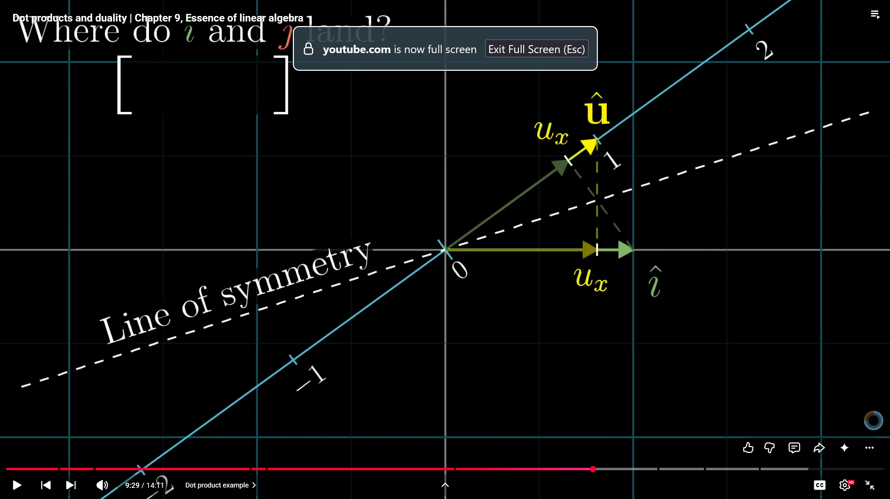

physics student perspective of vector as an arrow in space with a direction and magnitude
computer science student perspective of vector as ordered list of numbers with some features
- ive thought about the direction vectors both ways. cs perspective was more helpful in being clear what direction vector is in terms of image change. physics perspective is more helpful in manifold view

vector addition = adding numbers 
vector multiplication = multiplying scala by numbers
- number * vector scales the magnitude of the vector, never the direction
- numbers that SCALE vectors are called SCALARS. used interchangeably with number

-------------------------

unit vector - 1 unit vector
î - unit vector in x direction
ĵ - unit vector in y direction
- are basis vectors of xy coordinate system because every vector eg. [3, -2] can be represented in terms of them: [ 3î, -2ĵ ]
- svd gives the "unit vectors" for the dimensions the data has most variance in
- this is why svd/pca always gives perpendicular directions because axes are always perpendicular

every pair of (perpendicular?) basis vectors for xy plane can reach every coordinate
- if vectors line up then they can only trace a line
- dont think they have to be fully perpendicular. just some movement in a different perpendicular direction is enough.

linear combination of basis vectors aî + bĵ called linear combination
- set of all linear combinations you can reach is called span
- span is set of all possible vectors by scaling each basis vector and adding them together

if thinking about vector individually - helpful to think of it as arrow
if thinking about multiple vectors - helpful to think as a collection of dots
- a manifold is a collection of direction vectors. can think of the direction vectors as either points on the plane of direction vectors or the manifold points 

when you have multiple vectors and can remove one without reducing the span
- we say they are linearly dependent
- one of the vectors can be expressed as linear combination of others since it's already in the span of the others

if all vectors add to span then they are called linearly independent

--------------

linear tranformation is just a function that takes in a vector and outputs another one
- transformation is a helpful word because it makes us think about the movement of vector arrows in space and how the set of all input arrows move to their output arrows/points
- all linear transformations must keep lines straight (grid lines parallel and evenly spaced) and origin stay at origin
    - this might make curves in 1s manifold require more than linear transformations? 

linear transformations also change where î, ĵ end up. every vector can be described as combination of them. so when we transform a given vector with linear transformation - we can deduce where it ends up by figuring out what î and ĵ transformed are then for a vector [ a, b ] we can do a*î + b*ĵ to figure out where it is when transformed
- any linear combination can be described by where the î and ĵ vectors land. plug in the original [ a, b ] coordinates and you know the exact coordinates for the vectors post linear transformation

matrix multiplication is just a way to encode how the unit vectors change with a linear transformation and how to convert any normal xy vector into this new space

$$
\begin{bmatrix}
a & b \\
c & d
\end{bmatrix}
$$

we can think of a matrix as the $\hat{\imath}$ and $\hat{\jmath}$ vectors for a linear transformation. the vector $\begin{bmatrix} a \\ c \end{bmatrix}$ and $\begin{bmatrix} b \\ d \end{bmatrix}$ tell us what $\hat{\imath}$ and $\hat{\jmath}$ are after the linear transformation. 

earlier we learned that given a vector $\begin{bmatrix} x \\ y \end{bmatrix}$ you can describe it as a combination of the basis vectors $\begin{bmatrix} 1 \\ 0 \end{bmatrix}$ and $\begin{bmatrix} 0 \\ 1 \end{bmatrix}$ which are the basis vectors for the xy coordinate plane. 

in the same way given the $\hat{\imath}$ and $\hat{\jmath}$ for this new linear transformation you can describe where any vector goes. 

so if we treat $\begin{bmatrix} a \\ c \end{bmatrix}$ and $\begin{bmatrix} b \\ d \end{bmatrix}$ as our vector and we want to know where $\begin{bmatrix} 2 \\ 3 \end{bmatrix}$ goes then we do $2\begin{bmatrix} a \\ c \end{bmatrix}$ to find the x coordinate and $3\begin{bmatrix} b \\ d \end{bmatrix}$ to find where the y coordinate is. then we add these 2 vectors $\begin{bmatrix} 2a \\ 2c \end{bmatrix} + \begin{bmatrix} 3b \\ 3d \end{bmatrix}$ to find where the vector lands. simplified for the multiple of matrix

$$
\begin{bmatrix}
a & b \\
c & d
\end{bmatrix}
\begin{bmatrix} x \\ y \end{bmatrix}
$$

we do

$$
x\begin{bmatrix} a \\ c \end{bmatrix}
+ y\begin{bmatrix} b \\ d \end{bmatrix}
$$

then

$$
\begin{bmatrix} ax \\ cx \end{bmatrix}
+ \begin{bmatrix} by \\ dy \end{bmatrix}
$$

then

$$
\begin{bmatrix}
ax + by \\
cx + dy
\end{bmatrix}
$$

linear transformations can be chained one after another. these are called the composition of 2 linear transformations

----------------

$$
m_2 = \begin{bmatrix} 0 & 2 \\ 1 & 0 \end{bmatrix}
\qquad
m_1 = \begin{bmatrix} 1 & -2 \\ 1 & 0 \end{bmatrix}
$$

if we want to figure out the composition of these 2 vectors meaning what does the total linear transformation look like then we know that we first apply $m_1$'s $\hat{\imath}$ and $\hat{\jmath}$ vectors.

after applying $m_1$ the $\hat{\imath}$ is $\begin{bmatrix} 1 \\ 1 \end{bmatrix}$ and $\hat{\jmath}$ is $\begin{bmatrix} -2 \\ 0 \end{bmatrix}$

this gives us 2 vectors and we want to find how $\hat{\imath}$ and $\hat{\jmath}$ change after applying $m_2$. so we do what we learned last time.

$$
\begin{aligned}
\hat{\imath}
&= \begin{bmatrix} 0 & 2 \\ 1 & 0 \end{bmatrix}
\begin{bmatrix} 1 \\ 1 \end{bmatrix} \\
&= \begin{bmatrix} 0\cdot 1 + 2\cdot 1 \\ 1\cdot 1 + 0\cdot 1 \end{bmatrix} \\
&= \begin{bmatrix} 2 \\ 1 \end{bmatrix}
\end{aligned}
$$

$$
\begin{aligned}
\hat{\jmath}
&= \begin{bmatrix} 0 & 2 \\ 1 & 0 \end{bmatrix}
\begin{bmatrix} -2 \\ 0 \end{bmatrix} \\
&= \begin{bmatrix} 0\cdot(-2) + 2\cdot 0 \\ 1\cdot(-2) + 0\cdot 0 \end{bmatrix} \\
&= \begin{bmatrix} 0 \\ -2 \end{bmatrix}
\end{aligned}
$$

the composition of

$$
\begin{aligned}
m_2 m_1 &= \begin{bmatrix} \hat{\imath} & \hat{\jmath} \end{bmatrix} \\
&= \begin{bmatrix} 2 & 0 \\ 1 & -2 \end{bmatrix}
\end{aligned}
$$

in general this means matrix multiplication is
$$
\begin{aligned}
\begin{bmatrix} a & b \\ c & d \end{bmatrix}
\begin{bmatrix} e & f \\ g & h \end{bmatrix}
&= \begin{bmatrix}
e\begin{bmatrix} a \\ c \end{bmatrix} + g\begin{bmatrix} b \\ d \end{bmatrix}
& f\begin{bmatrix} a \\ c \end{bmatrix} + h\begin{bmatrix} b \\ d \end{bmatrix}
\end{bmatrix} \\
&= \begin{bmatrix}
a\cdot e + b\cdot g & a\cdot f + b\cdot h \\
c\cdot e + d\cdot g & c\cdot f + d\cdot h
\end{bmatrix}
\end{aligned}
$$

-----------
doing 3x3 matrix multiplication follows same principles as 2x2 matrix multiplication. the fundamental question is where do the basis vectors land after this transformation. you have the basis vectors from the m1 matrix. you then ask for each of the coordinates of that vector where do they end up? then repeat that process for each basis vector in m1.

matrix multiplication combines separate linear transformations into a single linear transformation. perhaps the key to having "explainable knobs" for the generated 1s manifold is to have the linear transformation decomposed into simpler transformations first. simpler can mean theyre part of a basic set like shear, rotate, etc. is there a set of linear transformations that completely spans the set of all possible linear transformations? maybe the key would be describing every linear transformation as a decomposed product of that set.

--------------------
if we look at the î and ĵ vectors in normal xy coordinates. they form a 1x1 square. if we applied linear transformations like rotations, î and ĵ change but they still form a 1x1 square. if we were to apply a scaling linear transformation then the î and ĵ vectors might form a 3x2 square now. the determinant is just a measure of how different the square formed by î and ĵ vectors before and after a linear transformation is
- if the determinant is 6 that means the square formed by î and ĵ has 6 times more area than before
- if the determinant is 0 that means the square formed has no area. in other words the linear transformation squishes the î and ĵ vectors into a single line or squishing everything into smaller dimension
- since the î and ĵ vectors are the basis vectors, by telling us how the 1x1 square changes, they tell us how every area is scaled

determinants can be negative. the absolute value still tells us how much a specific square/volume has changed. the negative tells us the orientation of space has changed
- oritentation of space changing meaning high level the direction between the axes has changed? like in 2d instead of ĵ being to the left of î, it is flipped and ĵ is to the right of î
- similar thing in 3d with oritentation of vectors being switched

$$
\det\begin{bmatrix}
a & b \\
c & d
\end{bmatrix} = ad - bc
$$

the î vector coordinates are a,c and ĵ vector coordinates are b,d. for î, a gives us the x coordinate and c gives us the y coordinate, same for ĵ. this means a*d gives us how much the x vector's x coordinate stretches by multiplied by how much the y vector's y coordinate stretches by. this gives us an overall measure of how much the 1x1 square is stretched

b and d give us how much the x vector's y coordinate changes and the y vector's x coordinate changes. this gives us how much the 1x1 area changes in diagonal direction. basically the orientation of space term. 

-----------------
linear systems of equations can be described as Ax = b where A is a vector of the coeffecients in the system and b is the sums. We can think of A as a set of linear transformations that when applied to an unknown set of vectors, x, result in b. So if we want to find the unknown vectors we have to apply A in reverse to b. This gives us $A^{-1}$ and when applied to b gives us the unknown vectors

if the determinant of A is 0 that means there might not be a solution that exists. This is because a determinant of 0 means the space is squished down to lower dimension. The only solutions that can exist have to lie along the space of that lower dimension

when a linear transformation results in an output of dimension 1, we say it has rank 1. rank means how many dimensions the output of a linear dimension lives in

column space of matrix is the span of the columns of your matrix. matrices are made up of basis vectors for each dimension. the span of those columns is the complete set of outputs possible by those basis vectors. so a column space tells you all the possible outputs possible by a linear transformation (matrix)

rank of matrix more precisely means number of dimensions in column space. when the rank equals number of columns meaning no dimensions are lost, we call it full rank. 

usually a linear transformation preserving dimension will take every input vector and point it somewhere else. if a linear transformation squishes dimensions this means multiple different input vectors now point to the same place. this can happen in the case of the origin too where input vectors were pointing elsewhere but after the transformation point to the origin. the set of vectors that point to origin are called null space or the kernel of your matrix. it's the space of all vectors that become null - that point to 0,0

When v in Ax = v is the 0/origin vector [0,0] the nullspace gives you all the possible solutions to the equation. all the transformations that convert an input vector to point to 0,0

----------------------
a non square matrix lets say 3 rows by 2 columns means that that is mapping a 2d input due to the 2 basis vectors into 3 dimensions because each vector has 3 coordinates
- column space is a 2d plane slicing through 3d space
- the columns give the basis vectors and the rows, number of coordinates in basis vector tells you where it lives in space. so 2 columns means we only need to know where 2 basis vectors go after the linear transformations. this means input is 2d. there are 3 coordinates for each basis vector so it lands in 3d space

-------------
dot products take 2 vectors and tell us how similar they are in direction vs perependicular

do not understand this part. the logic is explained as if we look at where u would be projected onto i, it would land at u_x. by the line of symmetry that means that i projected onto u would also land at u_x. but that makes literally no sense because u_x along the u vector is the point where u ends. like where the u vector points is where u_x is. that cannot be where i projects onto. 

watched it a few times and still have trouble understanding the core idea. but what i get is that the linear transformation to project one vector onto the other is like taking one of the vectors, turning it on its side and multiplying it. 

the number line intuition makes sense on its own to me but i dont understand how it extends beyond to perpendicular vectors. like what does it look like on the number line when a vector is perpendicular?

------------
cross product takes 2 vectors and outputs a vector which is perpendicular to both and also whose magnitude equals the area formed by the parallelogram of the 2 vectors. 
- basically take vector a and b place them on each other end to make a parallelogram and measure the area inside of it

-----------
idk

------------
