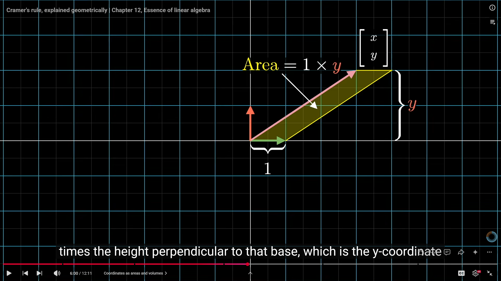
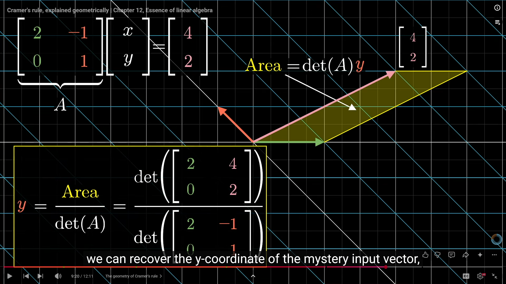

in higher dimension volumes - most of the volume is near surface

breaking down linear transformations into more basic ones

is there a set of linear transformations that completely spans the set of all possible linear transformations
- google search shows there is some work around here

find linear transformations from image a to b? i currently look at direction vector as like add these values to a to get to b. but what about linear transformations? is there any pattern?

-----------
cramer's rule

lets assume i and j are unit vectors and we have some Ax = b transformation where the pink line is the input x that gets transformed to b. If we make a parallelogram formed by j vector and x then the area of that parallelogram is 1 (i vector x coordinate) times y coordinate of x. Same for parallelogram formed by j and input vector

if we extend the previous logic and now transform i, j, and x into b - meaning after the "A" transformation, we can construct the same parallogram. we know before transformation the area of the parallelogram was y. Afterwards since the transformation scaled the grid, it scaled the area by a factor of determinant of A. This means area of the parallelogram = determinant of transformation * y

we can rearrange to say y = area / determinant of transformation. the area matrix is formed by the i basis vector and b which is the after transformation outpt vector. this gives us the value of y. we can repeat this idea for all the other coordinates. 

----------
change of basis - basically matrix multiplication with different basis vectors with systems of equations

changing transformation matrices according to different language
1. first take a vector in the alternate basis
2. multiply by transformation to convert it into our basis
3. apply transformation we want to apply in our basis
4. apply by inverse of #2 to translate it into their basis again

looks something like: A^-1 * M * A * input_vector where A is the transformation matrix to change basis and M is the transformation to apply in our language