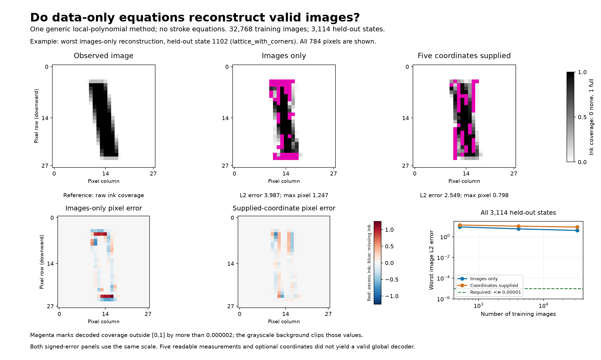

# Data-only five-coordinate experiment

**The full-family goal was not met.** Removing the supplied stroke geometry
made a large difference. Five readable image measurements provide promising
local coordinates, and a generic piecewise equation learned a local transition
from data. Neither images alone nor images with their five supplied settings
yielded a compact, accurate decoder of the whole family in this experiment.

This is a failure of the tested route, not a proof that the goal is impossible.
The original knob meanings were not required or used as a success condition.

## What the learner received

Two conditions used the same raw float32 coverage images:

- **Images only:** raw arrays, their pixel locations, and the target of five
  coordinates. No parameter values, intervention IDs, or renderer information.
- **Optional coordinates:** the same arrays and their five numerical setting
  columns, with no names, units, parameter bounds, or transformation laws.
  This condition tests conditional decoding; its five supplied controls are
  already available, so it does not claim to discover their meanings.

The learner uses generic spatial moments and local polynomial equations. It
contains no straight-strip measurements, top/bottom extraction, constant-width
assumption, line fitting, coverage-overlap formulas, subrow count, trigonometric
feature, or previous inverse. Generic image-grid knowledge, nonnegative ink,
low polynomial degree, and piecewise smoothness are explicit assumptions.

`learn.py` and `crease.py` import only NumPy, SciPy, itertools, and each other.
They read no files and import no generator. The independent checker audits
these imports and filesystem-call restrictions. This is software isolation;
the researcher already knows this synthetic family. It is not a claim that
the human experiment design was blind.

The oracle in `run.py` prepares data, keeps the renderer private to evaluation,
and constructs hard test cases after hyperparameters are frozen. No renderer
query, derivative, physical meaning, or range bound enters fitting.

## Five candidate coordinates from images alone

Start with ordinary image measurements through second order. Using training
and validation images only, select five of six measurements by prediction
error. The selected measurements were:

1. **Total ink:** sum of all coverage values.
2. **Horizontal ink center:** ink-weighted average pixel-column position.
3. **Vertical ink center:** ink-weighted average pixel-row position.
4. **Horizontal spread squared:** ink-weighted mean squared horizontal distance
   from that center.
5. **Cross-spread:** ink-weighted average of horizontal offset times vertical
   offset. Its sign indicates whether upper ink tends to lie right or left of
   lower ink; its size also depends on spatial spread.

The omitted measurement was vertical spread squared. Selection used no
physical parameter values. For image `X`, column position `x`, row position
`y`, and total ink `A`, the selected formulas are

```
A = sum X
horizontal_center = sum(x*X)/A
vertical_center   = sum(y*X)/A
horizontal_spread_squared = sum((x-horizontal_center)^2*X)/A
cross_spread = sum((x-horizontal_center)*(y-vertical_center)*X)/A
```

These meanings do not depend on knowing that the object is a straight stroke.
They are **candidate coordinates**, not yet certified global knobs. In the
oracle's numerical rank test at 256 held-out states, the smallest/largest
singular-value ratio was never below 0.00190. A search from two initializations
at each of 16 states found no distinct-image collision in these measurements.
These are positive local diagnostics, not proofs of global injectivity.

Their permitted domain is a further unresolved issue. Every measurement's
individual observed minimum/maximum does not define a valid rectangular
five-control domain. Oracle searches failed to find valid states for all 12
random measurement-box requests and 8 of 12 measurement chords. Failed
optimization is not proof those requests are impossible. It does show that
this experiment has not established a usable global domain rule. The oracle
search is evaluation only and is not shipped as a discovered decoder.

## One decoder route, rather than a model survey

For a requested five-number coordinate:

1. Standardize columns by their training standard deviations.
2. Find nearby observed coordinate rows.
3. Fit a weighted low-degree polynomial to the nearby raw images.
4. Evaluate that polynomial at the requested coordinate.

The polynomial is shared across coordinates, with a coefficient for each
pixel. All 784 pixels are checked; exact training-constant channels are stored
without regression. There is no variance cutoff or pixel denoising.

Degree and neighborhood size were selected on 128 independent validation
images. Both information conditions selected degree three and 128 neighbors.
The implementation uses [SciPy's documented nearest-neighbor query](https://docs.scipy.org/doc/scipy/reference/generated/scipy.spatial.cKDTree.query.html).

This gives an explicit numerical equation but retains examples and coefficient
tables. Even excellent accuracy would not automatically make it a compact,
understandable generative mechanism. That explanation requirement remains
separate from the numerical test.

## Whole-family results

Success was fixed before fitting: maximum absolute pixel error at most **2e-6**
and maximum Euclidean image error at most **1e-5**, with no output clipping.
The target was not relaxed after observing failure.

There were **3,114 held-out states**, including 1,024 joint random states,
a full lattice with all corners, near-range faces, exact/near cap and side
rendering transitions, and new joint paths. The evaluator used renderer
knowledge to generate hard cases, never to fit the learner.

| Training images | Images only: maximum pixel / image L2 | Supplied coordinates: maximum pixel / image L2 |
|---:|---:|---:|
| 512 | 3.112 / 8.781 | 4.334 / 13.310 |
| 4,096 | 2.235 / 5.711 | 3.026 / 10.348 |
| 32,768 | 1.247 / 3.987 | 2.386 / 8.587 |

At 32,768 images, median image L2 errors were 0.116 and 0.286 respectively.
The worst cases were lattice states, including corners. Even ordinary unseen
joint states had maximum image errors 0.675 and 1.954, so the failure is not
confined to exact range boundaries. Every test image had some predicted pixel
outside `[0,1]` by more than 2e-6. The prediction ranges were:

- Images only: **-0.551 to 2.247**.
- Supplied coordinates: **-1.957 to 2.904**.

Those are decisive validity failures: raw coverage cannot be negative or
exceed one. Clipping would hide this evidence without making an image a
member of the family.

The optional-coordinate condition doing worse here does not mean coordinate
values reduce information. The estimator uses standardized coordinate distance;
the supplied coordinates and moment coordinates induce different neighborhoods.
No claim about the best possible supervised learner follows from this result.

For scale, 32,768 points equals only `8^5`: the count in a five-dimensional
grid with eight settings per axis. The successful tiny local fits do not imply
that these global neighborhoods stay inside one formula region. This is a
data-resolution explanation, not a lower bound on the data needed by a better
algorithm. A shared mechanism should reuse structure across regions rather
than require a huge dense grid.

A single global cubic also failed: maximum pixel errors 1.512 and 1.241,
with image L2 errors 6.252 and 5.045. Its 56 terms give 43,904 pixel
coefficients. The more accurate neighborhood method retains 25,853,952 numeric
values, about 104 MB uncompressed. Neither is the requested small mechanism.

A separately learned inverse from six image moments to the five supplied
coordinates did not rescue reconstruction. Its image roundtrip had maximum
pixel error 2.396 and image L2 error 7.436. Encoder and decoder accuracy were
measured separately rather than conflated.



The figure shows the worst images-only case and a full-test convergence
control. Magenta explicitly marks coverage violations. Signed residuals use
a common scale, with red meaning excess ink and blue missing ink. It was
rendered and inspected using the repository's experiment-figure understanding
check. The conclusion is restricted to this decoder route.

## What did work locally

To distinguish inadequate local coordinates from a bad global formula,
the evaluator supplied dense samples in small neighborhoods. The learner
received only arrays and, in the optional condition, coordinate rows.

At one generic center, a cubic fit over a neighborhood radius of 0.0001 of
each input range reconstructed independent float64 observations to about
1.3e-14 maximum pixel error in both conditions. With float32 observations,
errors were about 7e-8. Expanding that neighborhood crossed pixel formula
changes and caused much larger errors. A neighborhood centered on a
transition retained error proportional to neighborhood size, consistent with
a missing piecewise branch rather than an additional independent coordinate.

These are conditional small-patch results, not a global chart or mechanism.
The range-normalized neighborhood sizes are an evaluator sampling convention;
these ranges were not supplied as input to the learner.

### Learn one transition without supplying its equation

The focused follow-up adds one generic crease to the same polynomial route:

```
predicted pixel array = P3(u) + max(0, v dot u - b) * Q2(u)
```

- `u`: standardized input coordinates, either the five image measurements or
  the five supplied values.
- `P3`: a fitted polynomial through degree three.
- `v dot u - b`: a fitted boundary separating two formula regions.
- `max(0,...)`: activates the second formula on one side of that boundary.
- `Q2`: a fitted polynomial through degree two.

The plane orientation and threshold were fitted from training arrays only,
using generic axis and random initializations. They were not supplied. The
learner first uses a dominant training-residual pixel pattern to estimate the
crease, then fits and tests every pixel. This residual projection is an
optimization step, not a claim of variance-based reconstruction success.

**Sampling qualification:** the evaluator deliberately isolated one rendering
transition and generated 512 local training observations around it. This
localization uses oracle knowledge and is not automatic partition discovery
from the full unlabeled cloud. A first pilot inadvertently crossed a nearby
second transition; a single crease followed the dominant event and left
residual error. That multiple-event failure is retained. Fresh test states
were generated after freezing each primary plane.

On 1,024 independent local test states per condition:

| Information and precision | Maximum pixel error | Maximum image L2 error |
|---|---:|---:|
| Images only, float32 | 6.292e-8 | 1.587e-7 |
| Supplied coordinates, float32 | 7.706e-8 | 1.713e-7 |
| Images only, float64 diagnostic | 2.786e-10 | 4.490e-10 |
| Supplied coordinates, float64 diagnostic | 1.022e-14 | 6.876e-14 |

The supplied-coordinate float64 fit discovered a boundary very close to

```
second supplied coordinate - 0.5 * third supplied coordinate = 4.75
```

The other three fitted coefficients were below 2.5e-11 relative to the
largest coefficient; the fitted half coefficient differed by about 5e-11.
The learner was not told the physical meaning. After fitting, the evaluator
can interpret this as a cap crossing a sampling boundary. It is a real
local structure learned from data, but it does not recover the entire raster
rule or establish that this boundary formula applies globally.

The ordinary cubic on the same isolated patch had errors around 6e-7 per
pixel. Those already satisfy the coarse float32 acceptance threshold; the
learned crease chiefly exposes the transition and improves accuracy toward
the storage floor. It should not be sold as turning a failed global model
into a successful one.

The float32 fitted plane is less precise and has small spurious coefficients.
Its extrapolation outside the training neighborhood is unsupported. Each
piecewise pixel model still has 60,368 coefficients. The local transition
relation is simple; the full local coefficient table is not yet an explanatory
pixel-generation mechanism.

## Precision, mathematical status, and remaining obstruction

All reconstruction maxima, rank tests, collision searches, and fitted equations
here are empirical. No full-family identity or domain certificate was obtained.
The generic moment formulas and polynomial evaluation rules are mathematical
identities, but they do not establish that the learned decoder equals the
original renderer between observations.

Float32 rounding is not the main explanation for the global failure. For
fixed supplied-coordinate queries, the largest observed interpolation-weight
L1 norm was 74.101. A per-training-pixel storage perturbation bounded by
`2^-25` changes the same linear interpolation prediction by at most
`74.101 * 2^-25 < 2.209e-6` per pixel, in exact arithmetic. This conditional
rounding-propagation bound is vastly smaller than the observed 2.386 error.
It does not certify binary64 arithmetic or account for changes of image-derived
query coordinates. The separate local float32/float64 tests expose the
storage floor directly.

The model was given no subrow sampling rule. It learned one change of formula
from data but did not infer a repeated global grid, all side/cap events, a
shared law for their pixel coefficients, or an exact nonlinear coordinate
transformation that simplifies them. Those are the missing discovery steps.
More data reduced typical error without yielding that small mechanism.

Relaxing original-knob recovery was legitimate and removed that semantic
identifiability requirement. It did not by itself supply the decoder structure.
The evidence supports further work on learning and connecting repeated formula
regions, not a claim that no five-coordinate explanation can be learned.
A next successful method must turn these local relations into a shared global
program and establish its permitted domain; assembling a large collection of
polynomial tables alone would still fall short.

## Reproduce

From the repository root, using the existing environment:

```bash
OPENBLAS_NUM_THREADS=1 .venv/bin/python experiments/generated_one_data_only/run.py
OPENBLAS_NUM_THREADS=1 .venv/bin/python experiments/generated_one_data_only/hinge_run.py
OPENBLAS_NUM_THREADS=1 .venv/bin/python experiments/generated_one_data_only/check.py
OPENBLAS_NUM_THREADS=1 .venv/bin/python experiments/generated_one_data_only/figure.py
```

The checker imports neither discovery module nor renderer. It independently
implements moments, polynomial evaluation, and neighborhood regression,
recomputes 66 held-out predictions per whole-family condition, checks all
stored full-test errors, and evaluates all 4,096 local crease predictions.
It verifies source/model hashes and reports **reproduction passed, full-family
explanation not recovered**. Reproducing a failed hypothesis is a passing
checker result, not a scientific success.

- [Original frozen protocol](../../experiments/generated_one_data_only/PROTOCOL.md)
- [Follow-up protocol](../../experiments/generated_one_data_only/HINGE_PROTOCOL.md)
- [Generic learner](../../experiments/generated_one_data_only/learn.py)
- [Generic crease learner](../../experiments/generated_one_data_only/crease.py)
- [Independent checker](../../experiments/generated_one_data_only/check.py)
- [Whole-family results and worst cases](results.json)
- [Local transition results](crease_results.json)
- [Independent checker results](checker_results.json)
